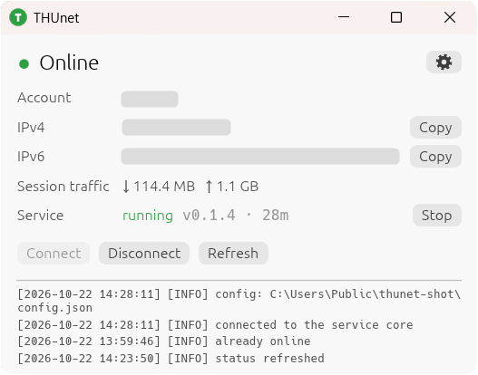
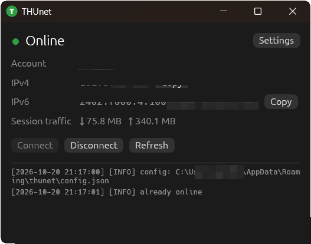
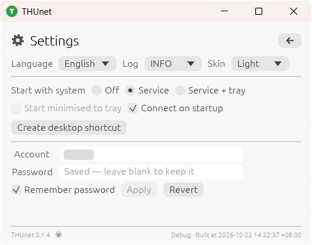
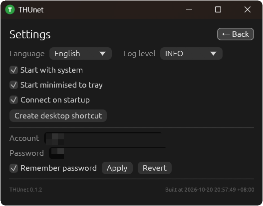
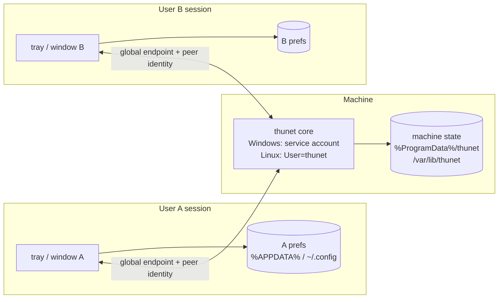

# THUnet

**English** | [简体中文](README.zh-CN.md)

A small cross-platform tray app that logs you into the Tsinghua University campus network (`auth4.tsinghua.edu.cn`, SRun3K portal) and keeps the connection alive.

One executable, no runtime dependencies, no console window, runs on Windows, Linux and macOS, and speaks Chinese or English.

> **New here?** Read [Quick start](#1-quick-start) — you only need your TUNET account name and password. The protocol details are at the very end of this document; you never need them to use the app.

## Contents

**Getting started**

1. [Quick start](#1-quick-start)
2. [The window at a glance](#2-the-window-at-a-glance)
3. [Everyday tasks](#3-everyday-tasks)
4. [Troubleshooting](#4-troubleshooting)
5. [Command line](#5-command-line)

**Reference**

6. [Where your data lives](#6-where-your-data-lives)
7. [Installing, uninstalling, shortcuts](#7-installing-uninstalling-shortcuts)
8. [Installing with winget](#8-installing-with-winget)

**For the curious / for developers**

9. [How the network login actually works](#9-how-the-network-login-actually-works)
10. [Building from source](#10-building-from-source)
11. [Project layout](#11-project-layout)
12. [Limits and notes](#12-limits-and-notes)
13. [Shared machines: the multi-user design](#13-shared-machines-the-multi-user-design)
14. [License](#14-license)

---

## 1. Quick start

1. **Get the executable.** Take the installer for your system (recommended), or build it yourself (see [Building from source](#10-building-from-source)):

   | System | File | Install with |
   | --- | --- | --- |
   | Windows | `thunet-<version>-x64.msi` | double-click, `msiexec /i thunet-<version>-x64.msi` (administrator rights, installs to `Program Files`), or `winget install --id THUnet.THUnet -e` once published (see [Installing with winget](#8-installing-with-winget)) |
   | Debian / Ubuntu | `thunet_<version>-1_amd64.deb` | `sudo apt install ./thunet_<version>-1_amd64.deb` |
   | other Linux | `thunet-<version>-linux-x64.tar.gz` | unpack and run `./thunet` (optionally `./thunet shortcut` for a desktop launcher) |

2. **Run it.** Start `THUnet` from the Start Menu / application menu, or run `thunet` in a terminal. A small window opens; everything the app does is written to the log strip at the bottom of that window.
3. **Open Settings.** Click the gear in the top-right corner of the window.
4. **Enter your credentials.** Type your TUNET account (for example `1234567890`) and your password, tick **Remember password**, then click **Apply**. The password is sealed with a random per-install key before it touches the disk, and never ends up in the settings file. The core owns that key and the sealed blob; the window never reads them back.
5. **Connect.** Go back to the Status page and click **Connect** (or just wait a few seconds if *Auto connect* is already enabled). The dot in the header turns green and your IPv4 address appears.

That is all. From now on the app reconnects by itself whenever the network comes back, and closing the window only hides it in the tray.

**Optional, worth doing once:**

- Settings → **Start with the system**, so the client is already running after a reboot.
- Settings → **Start minimised to tray**, if you do not want the window to pop up at login.
- Settings → **Language**, to pick 中文 or English instead of following the system language.

## 2. The window at a glance

The window has exactly two pages, switched with the gear in the top-right corner; the arrow in the same place on the settings page leads back. It opens in the middle of the monitor, and a fixed size means each launch starts from the same place.

| Light | Dark |
| --- | --- |
|  |  |

*The status page, in the light and the dark skin.*

### Status page

| Element | Meaning |
| --- | --- |
| Coloured dot + label | `Online`, `Authenticating` or `Offline` |
| `Account` | The account the portal reports for the current session |
| `Link` | Which interface carries the default route: `Ethernet` / `WLAN` / `No link`. With a cable and Wi-Fi both up it names the one the OS actually routes on — the first thing to look at when a session appears to come and go |
| `IPv4` / `IPv6` | Addresses assigned by the campus network, each with a **Copy** button |
| `Session traffic` | Bytes downloaded / uploaded during this session |
| `Service` | Whether a core is answering, with its version and uptime; it turns to `not running` as soon as the core is stopped. The button beside it stops or starts that process — like `thunet service stop`, it never closes the window. In a portable setup the row is called `Core`, says `runs in this window`, and has no button: there the core is a thread of the window and cannot outlive it |
| **Connect** / **Disconnect** / **Refresh** | Manual actions; only the ones that make sense are enabled |
| Log strip | The most recent events, newest at the bottom |

Log lines look like this:

```
[2026-10-20 12:56:26] [INFO] connected
[2026-10-20 12:56:41] [DEBUG] portal: auth4.tsinghua.edu.cn
```

Each level (`DEBUG`, `INFO`, `WARN`, `ERROR`, `FATAL`) has its own colour. Log text is always English — it is developer-facing diagnostics, so it does not follow the *Language* setting; everything else in the window does. The strip shows the newest lines and scrolls.

*Settings → Log level* hides lines below the chosen level (`DEBUG` shows everything, then `INFO`, `WARN`, `ERROR`). Hiding is display-only: the lines are still kept, so lowering the level again brings them back.

Right-click on selected log text copies the selection straight to the clipboard. With nothing selected, right-click opens a small menu with **Copy line** and **Copy all** (both copy only what the current level shows).

### Settings page

| Light | Dark |
| --- | --- |
|  |  |

*The settings page, in the light and the dark skin.*

| Setting | Effect |
| --- | --- |
| Start with the system | Three modes on one row: Off / Service / Service + tray (see [7](#7-install-uninstall-shortcut)). "Tray only" is not offered — the tray never starts a core by itself, so the icon would only ever report "service not running". On both platforms this row needs administrator rights: registering or changing the service, and starting or stopping it. The tray part alone is per user and needs no elevation once the service is already enabled |
| Start minimised to tray | On the same row as *Auto connect*, and independent of the autostart row above: autostart can stay hidden while a manual launch opens the window, or the other way round. Greyed out in *Service*, where no tray starts |
| Auto connect | Log in as soon as a usable network appears |
| Create desktop shortcut | Puts a launcher for the running executable on your desktop (the same action as `thunet shortcut`) |
| Account / Password / Remember password / Apply / Revert | This is the only row that does not save as you type: the button turns into the accent colour and an *Unsaved* marker appears while it differs from what is stored. Applying seals the password into `credential.bin` (never into the JSON file) and passes it to the running session immediately; if the service is down, Apply asks to start it first (administrator) and sends the credential once it answers. The window keeps no copy afterwards: the field goes blank and its placeholder says the saved value is kept, and re-typing the stored password is compared against the core (`CheckCredentials`) so it does not look unsaved. *Revert* drops the edits and restores the stored account, password and checkbox (it is greyed out while *Remember password* is off, since there is nothing stored to go back to) |
| Language | Follow system (default), 中文, English |
| Skin | Follow system (default), Light, Dark. Applied to the window immediately, and remembered in `config.json`, so the next launch starts in the same skin |
| Log level | `DEBUG` / `INFO` / `WARN` / `ERROR`: the lowest level shown in the log page (`INFO` by default, stored in `config.json`) |
| Version | Version on the left, build time on the right (local clock to the second, with its UTC offset); the prefix says whether the binary is a `Release` or `Debug` build, so a local test package is never mistaken for a release one; the GitHub icon next to the version opens this repository |

The three switches confirm the state they just moved to in a toast (*Start with system: On*), because nothing else on the page changes when one of them is flipped.

**Connect** uses the password the background worker holds: at launch that is what the credential file has (only if *Remember password* was saved), and afterwards whatever was last applied — text typed into the fields does nothing until **Apply**, which is what the *Unsaved* marker warns about. Because the core owns the secret, the window never shows it back: at launch the field is empty with a *Saved — leave blank to keep it* hint, and *Remember password* reflects whether the core will load it again. Unticking *Remember password* and applying deletes the stored entry without logging out — the password the core already holds keeps working until the process exits. With no password anywhere, **Connect** reports it instead of sending an empty login to the portal.

**Applying while online replaces the session.** The portal keeps one session per address and proves a password only by accepting a login, so the core logs out, signs in with the new pair and — if the portal refuses it — signs the previous account straight back in. Nothing is written to `credential.bin` until the new pair has worked, which is what keeps the machine reachable when a typed password is wrong; the connection drops for about a second either way. When the core holds no credential to fall back on, Apply asks first, because a wrong password would leave the machine offline with nothing to sign back in with. With *Remember password* ticked both fields are required — a renamed account never inherits the old password — so Apply stays disabled until the password is retyped.

Having no saved password is not the same as being offline: the client keeps asking the portal for the session state either way, so an existing session (today's, or one another device on this network created) still shows up as online with its account, addresses and traffic.

The build stamp shows the version on the left and, on the right, the local time of the compile that produced this binary with its UTC offset (`Built at 2026-10-20 19:23:23 +08:00`). Both are embedded at build time (`build.rs`), so the stamp always matches the running executable — handy when you are not sure whether the update actually took. The wall clock is rendered in the timezone of whoever is looking, so the same binary reads differently on a machine set to another zone; the offset says which one you are seeing.

**Connect is greyed out off-campus.** A login can only succeed behind the campus portal, so the client probes the network every few seconds and disables the button — with the reason on hover — when the machine is on an 802.1X network such as `Tsinghua-Secure`, has no link at all, sits behind someone else's captive portal, or already reaches the internet without a portal. The same reason sits in an amber band at the top of the Status page, so it stays readable without hovering; the band is a warning rather than an error and goes away by itself once the probe sees a campus portal again. The same amber band reports *Auto connect is on, but no account or password is saved* — and, while a leftover portal session is still up, that it will not reconnect on its own. A configuration gap rather than a failure, which is why it is not red. A band that does not fit is cut after three lines with an ellipsis, and hovering it shows the whole text. **Refresh** stays available in every case, and **Disconnect** follows the session state alone, so an existing session can always be ended.

### Tray icon

**Left-click the tray icon** to show the window (or to bring an existing one back to the front); **double-click** it to hide the window again. Telling the two apart takes a fixed 300 ms, so a single click acts once that delay has passed. **Windows only**: the Linux tray is an AppIndicator, which reports no clicks and has no tooltip, so use `Show window` / `Hide window` in its menu there and read the state from the window.

**Right-click** for `Show window`, `Hide window`, `Connect`, `Disconnect` and `Quit`.

Closing the window hides it — the app keeps working. `Quit` ends the window and its tray icon only: the background service keeps running, whatever the autostart mode says, and is stopped explicitly from the status page's *Stop* button or with `thunet service stop`. A portable setup has no service to outlive the window — the core *is* a thread of it — but the two are tied to the same lifecycle: closing only hides both, and `Quit` ends both.

### Feedback messages

Every action answers with a coloured strip at the bottom of the window: **green** for success, **red** for failure, **blue** for information such as "already online", "copied", or the state a switch just moved to ("Start with system: On"). Nothing succeeds silently.

## 3. Everyday tasks

**Start the service** — the window never starts it by itself: while the `Service` row says `not running`, click **Start** next to it (or run `thunet service start`). On Windows, if the service is not registered yet, **Start** registers it first (one administrator prompt) and then asks the SCM to start it; it never falls back to a user-run process. A red banner at the top of the Status page says the same until a service answers again. **Stop** ends the machine service and leaves the window open.

The one exception is a portable setup (`--state-dir` / `THUNET_STATE_DIR`), where both platforms behave identically and there is no service at all: the core is a thread of the window, started with it and ended with it, so the status page has no *Start* / *Stop* / *Restart* — only a `Core` row that says `runs in this window`. Starting it again means naming the same directory (`thunet --state-dir …`); a bare `thunet` is machine mode, and `thunet core --state-dir …` runs the same core without a window. The `thunet service` verbs refuse to run in that mode for the same reason: they would act on the machine service while the window is looking at a separate, portable core.

**Log in and out** — use the buttons on the Status page, the tray menu, or `thunet login` / `thunet logout`. If a session already exists the client says so instead of authenticating twice.

**See your address** — the IPv4/IPv6 rows refresh automatically every 15 seconds while online. Click **Copy** and a confirmation strip appears.

**Keep it running without a window** — close the window. The tray icon stays, logging continues, and the session is kept alive with a request to the campus homepage every 5 minutes.

**Start with the computer** — Settings → *Start with the system*. Enable *Start minimised to tray* as well if the window should stay hidden (the autostart entry then carries `--minimized`). On both platforms the service half asks for administrator rights once: the background core is a machine-wide service, not a per-user process. The tray half is per user.

**Switch language** — Settings → *Language*. The choice is stored in the config file and applies immediately.

## 4. Troubleshooting

| Symptom | What to do |
| --- | --- |
| Log says `login rejected` / `E2901` | Wrong password. Re-enter it in Settings, tick *Remember password* again and click **Apply**. |
| Log says `E2808 Control policy not found` | The portal reported an unexpected access-controller id. The client normally detects it automatically; on a captive Wi-Fi it can only guess. Reconnect to the campus Wi-Fi and click **Refresh**. |
| Log says `E2553` | The account is already online elsewhere (phone, another laptop). Log out there first. |
| Internet works but no session appears | You are on `Tsinghua-Secure` or another 802.1X network, where no portal login is needed — the client stays idle by design. |
| Nothing happens after clicking **Connect** | Read the log strip. When the machine has no link at all, the client waits 30 s before retrying. |
| The status band says the service runs an older build | The window and the service came from different builds: an install replaced the binary while the old service kept running. Click **Restart** in the `Service` row (one administrator prompt), or run `thunet service restart`. |
| **Connect** is greyed out | The client does not think a login can work here (802.1X Wi-Fi such as `Tsinghua-Secure`, no link, another operator's portal, or the internet already works). Hover the button for the exact reason; **Refresh** still polls the portal. |
| **Connect** says `No account or password saved` | Nothing is available to log in with: type the password in Settings and click **Apply**. The client does not send an empty login to the portal. |
| The log says `the new credentials were not accepted` | An account switch was refused by the portal. The previous account is signed back in automatically and the stored credential was not touched, so the machine stays online; re-enter the password and apply again, or click **Revert** to drop the edit. |
| The window disappeared | It is in the tray. Click the tray icon (or use `Show window` in its menu). |
| The app crashed | Read `crash.log` next to `config.json` (see [Where your data lives](#6-where-your-data-lives)). The app has no console, so that file is the only record. |
| A command prints nothing in PowerShell | The binary has no console and PowerShell does not wait for it. Use `cmd /c thunet status` or `Start-Process -Wait thunet`. |

## 5. Command line

The window is the default mode; every subcommand is optional, and the same executable does both jobs.

```
thunet                       # tray + window (same as no arguments)
thunet --minimized           # start hidden in the tray
thunet core                  # background service: owns the network session
thunet service <action>      # install/uninstall/enable/disable/start/stop/restart/status
thunet quit                  # ask the running window to exit and wait until it is gone
thunet status                # JSON: service state + portal session/traffic
thunet login                 # ask the service to authenticate now
thunet logout                # ask the service to de-authenticate
thunet ac-id                 # portal ac_id the service is using
thunet config                # config path + effective settings
thunet shortcut              # create a desktop shortcut
thunet completions <shell>   # print a bash/zsh/fish/elvish/powershell completion script
thunet selftest              # note: the real test vectors live in `cargo test`
```

On Windows the MSI puts the executable in `C:\Program Files\THUnet\bin` and appends that directory to the system `PATH`, so `thunet` works in any shell started after the install; the `.deb` installs it as `/usr/bin/thunet`.

Completion scripts come from the same `clap` definition the parser uses, so they cover every subcommand (including `service <action>`) and every global flag:

```
thunet completions bash > ~/.local/share/bash-completion/completions/thunet
thunet completions zsh  > ~/.zfunc/_thunet        # with: fpath=(~/.zfunc $fpath)
thunet completions fish > ~/.config/fish/completions/thunet.fish
```

The `.deb` already installs bash, zsh and fish completions under `/usr/share`, so on Debian/Ubuntu they work right after `apt install` with nothing to set up.

The window is only a *frontend*. The network session lives in `thunet core`, which the window talks to over a machine-wide local socket (a named pipe on Windows, an abstract Unix socket on Linux). The window never starts that process on its own: it comes from autostart, `thunet service start`, or the *Start* button on the status page. Closing the window therefore keeps you online, and the core is the half that can start at boot — a systemd **system** unit on Linux, a **Windows service** on Windows, both registered by the *Start with the system* setting. Registering, starting and stopping the service needs administrator rights on both platforms.

`status`, `login`, `logout` and `ac-id` are frontends too: they ask the running service over that same socket instead of contacting the portal themselves, so there is exactly one owner of the session. With no service running they stop with an error naming the command that starts it — they never fall back to a second, unmanaged connection.

`thunet status` prints one object with both halves:

```json
{
  "core":   { "version": "0.1.4", "build_epoch": 1792571000, "pid": 1234,
              "uptime_secs": 812,
              "state": "Online", "env": "Campus", "ac_id": "169",
              "host": "auth4.tsinghua.edu.cn",
              "credential": { "username": "1234567890", "has_password": true,
                              "remembered": true, "revision": 2, "matches": null },
              "auto_connect": true,
              "wanted_online": true, "failures": 0, "frontends": 1,
              "endpoint": "/run/user/1000/thunet/control.sock" },
  "portal": { "error": "ok", "online_ip": "…", "bytes_in": … }
}
```

The `core` half describes the running service (`uptime_secs`, the network verdict in `env`, the attached frontends). If the portal query fails, `portal` is `null`, `portal_error` carries the reason, and the command exits non-zero.

Starting `thunet` while it is already running does **not** start a second copy: the existing window is brought back instead.

Global overrides: `--host <host>`, `--http`, `--timeout <secs>`, `-u/--username`, `-p/--password`, `--ip <addr>`, `--ac-id <id>`.

Precedence is **command line > config file > credential store**. `-u` / `-p` are handed to the service for `login` (in memory only, never written to disk), while `--host` / `--http` / `--timeout` shape what `thunet core` talks to: `thunet -u 1234567890 -p secret login`.

On a shared machine, do not put the password in `argv`: `/proc/<pid>/cmdline` is readable by other users on Linux (unless `hidepid=2`). Use the window, or a stored credential plus `thunet login`.

## 6. Where your data lives

There are two directories: the window's per-user preferences and the core's machine-wide state.

| | Per-user (window) | Machine-wide (core) |
| --- | --- | --- |
| Windows | `%APPDATA%\thunet\` | `%ProgramData%\thunet\` |
| macOS | `~/Library/Application Support/thunet/` | same as per-user (no service) |
| Linux | `$XDG_CONFIG_HOME/thunet/` (usually `~/.config/thunet/`) | `/var/lib/thunet/`, mode `0700`, owned by the service user |

Per-user files:

| File | Contents |
| --- | --- |
| `config.json` | Language, log level, start-minimised, and a mirror of the *Remember password* switch. **No password** — that field is skipped when serialising, and the authoritative switch is the core's copy. |
| `crash.log` | Appended only when the window panics. |

Machine-wide files:

| File | Contents |
| --- | --- |
| `config.json` | Account name, portal host, auto-connect, keepalive settings and whether the sealed credential should be loaded on the next start. **No password.** |
| `credential.bin` | The sealed account/password pair, mode `0600` / service-only ACL. |
| `key.bin` | A random 32-byte data key, mode `0600` / service-only ACL. |
| `core.log` | Diagnostics from the background core. |

Password storage is one implementation on every platform. `credential.bin` holds `MAGIC "THUNET-1" ‖ nonce ‖ ciphertext` (ChaCha20-Poly1305) with mode `0600`, under a **random 32-byte key** stored in `key.bin`. The key is never derived from the machine identity, and there is no older format: a blob with any other magic is treated as absent.

The window never opens either file: it sends `SetCredentials` and receives only a `CredentialState` — `{ username, has_password, remembered, revision }` — with no password, and asks `CheckCredentials` to compare a typed candidate against the sealed one. `remembered` is what the checkbox shows, and the core records it in its own `config.json`, so a service restart still reads the blob back. This is what lets every interactive user change the shared credential without being able to read it.

The protection is the directory ACL, not the encryption:

- Windows: `%ProgramData%\thunet` gets an explicit DACL with inheritance disabled, granting only the service SID, `SYSTEM` and Administrators.
- Linux: `StateDirectory=thunet` creates `/var/lib/thunet` as `0700`, owned by the dynamic service user.

A full-disk image that includes `key.bin` (and, on Linux, the systemd host key) can still be decrypted; only a TPM-bound key or a passphrase changes that. An administrator or root can read the key or dump the core's memory in any case.

Deleting the per-user directory resets the window's preferences. The machine directory belongs to the service and is kept across upgrades and reinstalls; a real uninstall removes it, which is also how you forget the shared account.

Deleting `config.json` resets every setting. A real uninstall (Windows *Uninstall*, `apt remove`) deletes the whole machine directory, including `credential.bin` and `key.bin`; an upgrade or a reinstall keeps it, so the account and the sealed password survive.

## 7. Installing, uninstalling, shortcuts

**THUnet is installed and removed by the operating system only** — the `.msi` on Windows, the `.deb` on Debian/Ubuntu. The application itself never copies files or writes uninstall entries; the one thing it does register is autostart (a logon task for the tray, a service for the core), and only when you ask for it. There is no "install for me" button and no `thunet install` command. That keeps one owner per installation and avoids the two registrations fighting over the same files.

| OS | Installed executable | Registration (created by the package) |
| --- | --- | --- |
| Windows | `C:\Program Files\THUnet\bin\thunet.exe` | Windows Installer entry in *Settings → Apps*, machine-wide Start Menu entry under `%ProgramData%\Microsoft\Windows\Start Menu\Programs\THUnet`, per-user desktop shortcut, and `C:\Program Files\THUnet\bin` appended to the system `PATH` |
| Linux | `/usr/bin/thunet` | `/usr/share/applications/thunet.desktop` and an icon under `/usr/share/icons/hicolor/scalable/apps/`, both system-wide |

The MSI is per-machine (`Scope="perMachine"`), which is what a single UAC prompt at install buys: the package owns machine-wide state, so it can stop the core service before files are replaced and delete it on uninstall — a per-user package runs unelevated and can do neither, leaving a service behind that points at a deleted executable. The trade is that install, upgrade and removal all ask for administrator rights once. The Start Menu entry is machine-wide too (spelled out under `CommonAppDataFolder`, i.e. `%ProgramData%`): WiX's `ProgramMenuFolder` resolves to the profile of whoever ran the installer, which on a per-machine package leaves a second, user-only copy next to the real one.

Settings are **per user** (`%APPDATA%\thunet`), while the core's account, portal host and sealed credential live in the machine directory (`%ProgramData%\thunet`). The service is registered by the application on the first *Start with the system* or the first click on the status page's **Start** (administrator), not by the MSI; the MSI stops, repoints and restarts it during upgrades.

Uninstalling while THUnet is running is safe: the MSI asks the window to quit through the app's own quit doorbell (`thunet quit`, executed hidden — closing the window would only hide it, and killing it would skip its shutdown), and stops the service through the Service Control Manager (`ControlService`, then waits for the process to be gone) before any file is touched. No external tool is spawned for either step, so nothing flashes a console window. A real uninstall then removes the service, deletes the machine directory (`%ProgramData%\thunet`, including `credential.bin` and `key.bin`), and finally removes the files, the shortcuts, the Start Menu folder and the install directory. A major upgrade stops the service the same way but keeps the registration and the machine state — and then points the registration at the executable that was just installed, so a package that moves the file does not leave the SCM launching a stale path; the tray logon task is rewritten the same way on the next launch.

Because that step also runs for upgrades and repairs, every interactive install (UILevel ≥ 4) starts the app again once the transaction is finished. It does so through the desktop shell's own `ShellExecute` (the WiX util extension's `WixUnelevatedShellExec`), which runs the tray with the user's own token instead of inheriting the installer's elevation — asking `explorer.exe` to do it opened a folder window instead of the app on some machines. A silent install (`msiexec /qn`, winget) does not start anything, so it never hijacks a desktop. Double-clicking the package while it is already installed therefore ends with the app running rather than with a closed copy.

Autostart registration is split by platform, but the rule is the same on both: **installing the package registers nothing that runs**. The Linux package ships the system unit and leaves it disabled; on Windows the service does not even exist until the app creates it. The core is registered the first time you pick a service mode or click **Start** (administrator), and the tray entry is per user. An upgrade keeps the previous state: a service that was enabled comes back on the new binary, one that was off stays off. The state is read back from the OS instead of stored in `config.json`. There are two entries (tray and background service) and three modes:

| Mode | Linux | Windows |
| --- | --- | --- |
| **Off** | nothing registered | nothing registered |
| **Service** | systemd system unit `thunet.service` enabled; starts at boot, before anybody logs in | the `thunet` **service** (virtual account `NT SERVICE\thunet`, start type `auto`): up before the login screen, no tray icon |
| **Service + tray** | unit + `~/.config/autostart/thunet.desktop` | that service + a per-user `thunet-tray-<user>` logon task |

There is deliberately no tray-only mode: the tray never starts a core by itself, so an icon without a service could only report "not running".

| OS | Autostart entry |
| --- | --- |
| Windows | The core is a **service** (`thunet`, virtual account `NT SERVICE\thunet`, `SERVICE_WIN32_OWN_PROCESS`) that the Service Control Manager starts at boot — before anyone logs on, which a logon task cannot do. Its state lives in `%ProgramData%\thunet`. The tray stays a per-user Task Scheduler logon task (`thunet-tray-<user>`, no delay, `InteractiveToken` + `LeastPrivilege`), which is what keeps the location permission working. Registering, starting and stopping the service takes administrator rights. |
| Linux | Tray: `~/.config/autostart/thunet.desktop`, started by the desktop session (XDG autostart), which every desktop honours, including the ones that never pull `graphical-session.target`. Core: a systemd **system** unit with `DynamicUser=yes` and `StateDirectory=thunet`; registering, starting and stopping it needs administrator rights (pkexec/polkit). |
| macOS | A LaunchAgent managed by the `auto-launch` crate; the core itself is started on demand (`thunet core`, `thunet service start`, or the status page's *Start* button). |

The package ships the system unit; a portable install can write it with `thunet service install` (administrator). `systemctl start|stop|status thunet` works without visiting the settings page. `thunet service <action>` wraps both platforms in the same verbs:

| Action | Linux | Windows |
| --- | --- | --- |
| `install` / `uninstall` | write / remove the system unit | create / delete the service, administrator only |
| `enable` / `disable` | put it in the boot path | set the service start type to `auto` / `demand`, administrator only |
| `start` / `stop` / `restart` | `systemctl …`, administrator only | `StartServiceW`, `ControlService`, administrator only |
| `status` | `systemctl status` | `QueryServiceStatusEx` + `QueryServiceConfig` |

Once the core is registered it belongs to systemd / the Service Control Manager: the window only reconnects to it and never spawns one behind the manager's back. `enable` and `disable` only decide what happens at the **next** boot; they never start or stop the running core — that is what `start` and `stop` are for.

On Linux the unit is written on first start even with autostart off, so `thunet service start|stop|status` works right away. On Windows the service is created by `thunet service install` (or by picking a service mode, or by the status page's **Start**), and `start|stop|status` then work without any further prompt.

The only self-service action left is the desktop shortcut: **Create desktop shortcut** on the Settings page, or `thunet shortcut`, which puts a launcher for the running executable on your desktop (on Linux it also marks the `.desktop` file as trusted so GNOME will launch it).

To remove THUnet: *Settings → Apps → THUnet → Uninstall* on Windows, or `sudo apt remove thunet` on Debian/Ubuntu. Your settings in `%APPDATA%\thunet` are left alone; delete that directory if you want a clean slate. Uninstalling needs no preparation on Windows: the package stops the tray and the core service, deletes both registrations (the service and the `thunet-tray-<user>` logon task) and removes the `PATH` entry. Turning *Start with the system* off first is harmless but not required.

## 8. Installing with winget

winget can install THUnet if a package manifest exists for it. There are three levels, from "just for me" to "available to everyone":

### 8.1 Already published (nothing to do)

Once the manifests are merged into the community repository this is all it takes:

```
winget install --id THUnet.THUnet -e
winget upgrade --id THUnet.THUnet -e
winget uninstall --id THUnet.THUnet -e
```

### 8.2 Install from the local manifests (no publishing)

This repository generates the manifests next to the MSI:

```
pixi run -e package winget         # -> dist/winget/*.yaml
```

Then, **in an elevated terminal** (the feature is off by default):

```
winget settings --enable LocalManifestFiles
winget validate --manifest dist\winget
winget install --manifest dist\winget
```

The generated `InstallerUrl` points at a GitHub release that has to exist; pass `-BaseUrl` to change it:

```
pwsh -File scripts/winget_manifest.ps1 -BaseUrl https://github.com/<you>/thunet/releases/download/v<version>
```

### 8.3 Publishing so anyone can `winget install THUnet.THUnet`

1. Upload `dist/thunet-<version>-x64.msi` to a release; keep the asset name stable — the manifest hash must match the exact bytes.
2. Regenerate the manifests with the real `-BaseUrl`, so `InstallerSha256` matches the uploaded file.
3. Submit them, either with [`wingetcreate`](https://github.com/microsoft/winget-create): `wingetcreate submit --token <GitHub PAT> dist/winget`, or by opening a pull request that adds the three YAML files under `manifests/t/THUnet/THUnet/<version>/` in [microsoft/winget-pkgs](https://github.com/microsoft/winget-pkgs).
4. After the automated validation passes and the PR is merged, `winget search THUnet` finds the package and install/upgrade/uninstall work as in 8.1.

Things the community repository will check: the installer URL must be public HTTPS, the SHA256 must match, the package must install **and** uninstall silently (`/qn` — the MSI does), and `Publisher` / `PackageName` should match what the installer writes to *Installed apps* (`THUnet contributors` / `THUnet`).

Two details exist only for the installation-validation step, and removing them brings back the `Validation-Executable-Error` label:

- `packaging/thunet.wxs` sets `ARPINSTALLLOCATION` so *Installed apps* records an `InstallLocation`; MSI never writes one on its own, and without it nothing can locate the installed executable.
- `scripts/winget_manifest.ps1` declares `thunet.exe` as the `InstallationMetadata` `launch` file with `InvocationParameter: --version`. THUnet is a tray client: started without arguments it stays resident until the user quits, which reads as a hung/failed program for anything that executes installed binaries. `--version` prints the version and exits 0 in well under a second.

> A package cannot be published for a version whose artifact is not reachable yet, so upload the release **before** opening the pull request.

Steps 1–3 are automated by [`.github/workflows/release.yml`](.github/workflows/release.yml): push a tag that matches `Cargo.toml` (`git tag v0.1.1 && git push origin v0.1.1`) and the workflow builds the MSI, publishes it with the generated manifests, and opens the `winget-pkgs` pull request when a `WINGET_TOKEN` secret (classic PAT with `public_repo`) is configured.

## 9. How the network login actually works

Everything is plain HTTP(S) against the portal — no browser and no JavaScript. The full walkthrough lives in **[docs/protocol.md](docs/protocol.md)**: network detection, `ac_id` discovery, the challenge token, `{MD5}` / `{SRBX1}` encoding, the checksum, session verification, keepalive and the portal error codes.

The implementation is in `src/srun.rs` (protocol) and `src/session.rs` (state machine); `src/crypto.rs` holds MD5/SHA-1/XXTEA. Nothing there is required to use the app.

## 10. Building from source

Prerequisites: Rust 1.90 or newer (edition 2024) and a C toolchain for the windowing dependencies. The repository pins everything through [pixi](https://pixi.sh):

```
pixi run -e dev cargo build --release
pixi run -e dev cargo test
pixi run -e dev cargo fmt
```

Editing with rust-analyzer needs one extra step, because the toolchain lives inside the pixi environment (Windows `Library/bin`, Linux `bin` plus the GTK `PKG_CONFIG_PATH`) and rust-analyzer is a separate process that cannot see it. `pixi run -e dev vscode-settings` writes the local, git-ignored `.vscode/settings.json` with this machine's paths, so the editor gets completion, hover, go-to-definition and diagnostics without being started from a pixi shell.

The release profile uses `lto`, `opt-level = "z"`, `codegen-units = 1`, `panic = "abort"` and `strip`, so the result is a single self-contained executable with no runtime assets — the window, tray icon and fonts are all created at runtime.

### Building the installers

Packaging lives in the `package` pixi environment and produces everything in `dist/`:

```
pixi run -e package msi        # Windows: thunet-<version>-x64.msi       (WiX v5)
pixi run -e package msi-debug  # Windows: thunet-<version>-x64-debug.msi (debug binary, fast)
pixi run -e package deb        # Debian/Ubuntu: thunet_<version>-1_amd64.deb
pixi run -e package deb-debug  # Debian/Ubuntu: thunet_<version>-1debug_amd64.deb (debug binary, fast)
pixi run -e package tarball    # any Linux: thunet-<version>-linux-x64.tar.gz
```

Sources:

| Path | Purpose |
| --- | --- |
| `packaging/thunet.wxs` | WiX v5 source of the per-machine MSI |
| `scripts/build_msi.ps1` | Reads the version and drives `wix build` |
| `scripts/build_tarball.sh` | Reads the version and packs the tarball |
| `Cargo.toml` → `[package.metadata.deb]` | Debian control fields and file list |
| `build.rs` | Embeds `assets/thunet.ico` (and the version block) into the exe |
| `assets/thunet.ico`, `assets/thunet.svg` | Icons used by the packages and shortcuts |
| `assets/thunet.desktop` | Launcher entry installed by the `.deb` |
| `assets/completions/` | bash/zsh/fish completion scripts installed by the `.deb`; a unit test keeps them in sync with the CLI |
| `scripts/make_icon.py` | Regenerates the icon assets (`pixi run -e tools python scripts/make_icon.py`) |

Notes:

- **The version has one source of truth: `Cargo.toml`.** The packaging scripts read it and pass it on (`wix build -d Version=…`, `cargo deb`, the tarball name), so nothing has to be edited by hand when bumping. An ad-hoc build can override it: `pwsh -File scripts/build_msi.ps1 -Version 0.2.0` or `bash scripts/build_tarball.sh 0.2.0`.
- **`msi-debug` packages `target/debug/thunet.exe`** (`build_msi.ps1 -BinPath … -Suffix -debug`) and skips the release profile's LTO, which is what makes the local loop slow. The resulting installer has the same product identity and install location as the release one, so installing it replaces whatever is installed; the settings footer shows `Debug` to make that obvious.
- **`deb-debug` packages a debug build of the same `.deb`.** cargo-deb refuses the built-in `dev` profile, so the build uses the `pkgdebug` profile (`target/pkgdebug/`, debug assertions and symbols kept, `--no-strip`); the `1debug` revision names the file and sorts above the release package, and the settings footer shows `Debug`.
- `dotnet` and WiX are installed inside `.pixi/` — nothing is added to your global .NET tool list and no admin rights are needed.
- Binaries are unsigned; Windows SmartScreen will warn on first run until a code signing certificate is used (`signtool sign /fd sha256 ...`).

## 11. Project layout

| File | Responsibility |
| --- | --- |
| `src/main.rs` | CLI entry, console/panic plumbing, GUI launch |
| `src/srun.rs` | portal HTTP client, `ac_id` detection, request building |
| `src/crypto.rs` | MD5, SHA-1, XXTEA and the portal base64 alphabet |
| `src/session.rs` | state machine: refresh, login, keepalive, logout, backoff |
| `src/ui.rs` | worker thread, window, tray, toasts, log strip |
| `src/config.rs` | settings load/save, platform paths |
| `src/secret.rs` | sealed credential file (one implementation for every platform) |
| `src/single.rs` | single-instance guard (second launch shows the first window) |
| `src/shortcut/` | desktop shortcut creation per platform |
| `src/i18n.rs` | Chinese/English strings |
| `src/logline.rs` | log record and `[YYYY-MM-DD HH:MM:SS] [LEVEL] msg` rendering |
| `src/wifi.rs` | current SSID, enterprise-Wi-Fi detection |
| `docs/protocol.md` | SRun3K login walkthrough (see §9) |
| `packaging/`, `scripts/` | installer sources and helper scripts |

## 12. Limits and notes

- Only the campus portal protocol is implemented; there is no 802.1X or VPN support.
- The saved password is sealed with a **random per-install key** (`key.bin`), and both it and `credential.bin` live in a directory only the service account and administrators can read: other users cannot read or copy it, and the control channel has no read-back command. An administrator/root can read the key or dump the core's memory, and a full-disk image without TPM binding can be decrypted. Section 13 explains the threat model and the ACL requirements.
- **“Connected before login” no longer depends on a user's home directory.** The core's state is in `%ProgramData%\thunet` / `/var/lib/thunet`, created by the installer or by systemd's `StateDirectory=` before the core starts. An encrypted home directory is irrelevant to the machine-wide service.
- The client trusts the portal's TLS certificate; `--http` exists for debugging only.
- On Linux the core is a **systemd** unit (`DynamicUser=`, `StateDirectory=`, `Restart=always`), so a running systemd is a requirement. The `.deb` does not depend on the `systemd` package: that would conflict with sysvinit distributions, and a package dependency cannot express "systemd is *running*" (WSL and containers have the package without the daemon). Without systemd only a portable `thunet core` works, and the service modes plus the status page's *Start* report a failure.
- `netsh`-based SSID detection needs Windows Location permission. Without it the client still works, but it cannot tell `Tsinghua-Secure` from a captive Wi-Fi — the internet probe then decides.
- On Windows the core runs as a **service** under the virtual account `NT SERVICE\thunet`, because only a service can start before a login. It reads `%ProgramData%\thunet` (the path travels as `--state-dir`), and its control pipe is machine-wide: interactive users may read state and drive the session, while start/stop and registration stay administrator-only.
- The single-instance guard brings the existing window back on every platform: Windows rings a session-local event, and on Linux/macOS the second launch leaves a marker file that the running instance polls, so the window is raised from inside the process that owns it.
- After an upgrade plus a service restart (`systemctl restart thunet`), a window still running the old build compares the two build stamps and relaunches itself on the new binary. A restart with the same build, or a copy whose own file was not replaced, leaves the window untouched.
- Right-click in the log strip copies whole lines; free-form selection copy uses the usual `Ctrl+C`.

## 13. Shared machines: the multi-user design

### 13.1 One machine, one core

The network session is a property of the machine (the portal authenticates the outgoing IP), so the core has to be too. Every logged-in user gets a tray/window; all of them talk to the same core.



Invariants:

- exactly one core per machine; it belongs to the machine, not to the user who installed or enabled it;
- any interactive user can drive the session: connect, disconnect, refresh, read status, change the shared credential;
- only the core can read or write the credential; no frontend can read it back;
- installing, removing, enabling/disabling at boot and starting/stopping the service require administrator rights;
- the tray entry is per user and needs no elevation.

### 13.2 Endpoint and peer identity

| | Windows | Linux |
| --- | --- | --- |
| Endpoint | service: `\\.\pipe\thunet-control` (global namespace); portable core: `\\.\pipe\thunet-control-<user>-<state tag>` | abstract socket `@thunet-control` (global in the network namespace); portable core: `$XDG_RUNTIME_DIR/thunet-<state tag>/control.sock` |
| Who may connect | service pipe: `SYSTEM`/`Administrators` full, `INTERACTIVE` (the well-known SID for users logged on interactively) read/write; portable pipe: only the user who started it | no file permissions; any local uid can connect |
| Peer identity | `ImpersonateNamedPipeClient` → token SID + session id | `SO_PEERCRED` → `ucred{pid,uid,gid}` |
| Server identity | `GetSecurityInfo` on the pipe handle → owner SID | `SO_PEERCRED` on the connected socket → server uid |
| Policy | reject session 0 / non-interactive tokens | **any local uid**: the abstract socket carries no permissions and there is no logind lookup, so every account on the machine may drive the shared core |

Both directions are checked. The core verifies that the caller is an interactive user; the window verifies that the process on the other end really is the service. Without the second check, a user could bind the free endpoint while the service is stopped and collect `SetCredentials` from other users' windows.

The two platforms are not equally strict, and the table says so: on Linux the frontend-to-core check reduces to "the caller is local", because the abstract socket has no permissions and `is_interactive()` answers `true` for every uid. Any account on the machine can therefore send `Connect`, `Disconnect` or `SetCredentials` to the shared core, and read its state — the same accounts that could already edit `/var/lib/thunet` once they are root, and root can do anything on either platform. Tightening this (only uids with an active logind session) would need a D-Bus dependency and is deliberately not implemented.

A filesystem socket (`$XDG_RUNTIME_DIR/thunet/control.sock`) is deliberately not used once the core is machine-wide: it is per user, so a second user's core would bind a different path and the "one core" rule would silently fail. An abstract socket has the same global-name property as a named pipe without needing a writable shared directory.

### 13.3 What needs administrator rights

| Operation | Windows | Linux |
| --- | --- | --- |
| install / uninstall | MSI | `apt` (via `dpkg`) |
| register / remove the service | `sc create` / `sc delete` | unit file in `/usr/lib/systemd/system` |
| enable / disable at boot | `sc config start= auto` or `start= demand` | `systemctl enable` / `disable` |
| start / stop | SCM (`SERVICE_START` / `SERVICE_STOP`), **administrator** | `systemctl start` / `stop` (polkit), **administrator** |
| change what the core runs as, or its state dir | `sc config binPath=` | unit file |
| change the portal host / TLS mode | installer / administrator only | installer / administrator only |
| change the shared account/password | no | no |
| connect / disconnect / refresh / status | no | no |
| "start the tray at my login" | no | no |

If zero-elevation recovery after the core is stopped were required, both sides would have to be opened up: on Windows, grant `INTERACTIVE` (the well-known SID for users logged on interactively, mentioned above) start/stop rights on the core service's DACL; on Linux, add a polkit rule that allows only `start` and `stop` on `thunet.service`. This project chooses the stricter side: **starting and stopping the core is administrator-only on both platforms**. The service manager starts it at boot and restarts it after a crash; the window can only ask the elevation helper, and the control channel has no command that stops the core.

The machine core has no `Shutdown` command on the control channel: the status page's *Stop* button calls SCM / systemd through the elevation helper, so the same authorization applies everywhere. A portable core does accept `Shutdown`: a hosted one stops its own core thread and leaves the window running, and a hand-started `thunet core` exits. After the window disconnects, no frontend starts a machine core on its own. A core that exits by itself (fatal error, upgrade) is restarted by the service manager.

`host`, `https` and the keepalive target are **machine configuration**, not user preferences. Letting an ordinary user change `host` would let them point the core at a portal they control and read the password: the SRun login encrypts `info` with a token chosen by the server, so the server can always decrypt it. The window and the control channel expose no way to change these values.

### 13.4 State and credentials

| | Windows | Linux |
| --- | --- | --- |
| Machine state | `%ProgramData%\thunet` | `/var/lib/thunet` |
| Permissions | explicit DACL, inheritance disabled: service SID + Administrators | `0700`, owner `thunet` (`StateDirectory=thunet`, `StateDirectoryMode=0700`) |
| Contents | `config.json` (no password), `credential.bin`, `key.bin`, `core.log` | same |
| Per-user prefs | `%APPDATA%\thunet` (language, log level, tray autostart) | `~/.config/thunet` |

The UI never opens `credential.bin`: it sends `SetCredentials` and receives only `{ username, has_password }` back. The core writes the file atomically with the service's own token. That is what makes "any user may change the shared credential, no user may read it" possible at all.

### 13.5 Can another user decrypt the password?

**Not if the permissions are right — and the encryption is not what stops them.**

- Open source changes nothing here (Kerckhoffs's principle): the format is public either way. Secrecy has to come from the key and from who can read the file.
- The machine directory enforces the boundary explicitly:
  - Windows: do not rely on `%ProgramData%`'s inherited ACL (it lets `Users` read); create the directory with an explicit DACL and disable inheritance. Verify with `icacls "C:\ProgramData\thunet"`.
  - Linux: `StateDirectory=thunet` creates `/var/lib/thunet` as `0700`; a `create_dir_all` under `/var/lib` uses the umask and usually ends up `0755`. Verify with `ls -ld /var/lib/thunet`.
- Encryption still has a job beyond permissions:
  - the **random** 32-byte data key in `key.bin` (`0600`, same ACL) makes a copied `credential.bin` alone useless;
  - optionally wrap that key with the OS: `systemd-creds` (host key, optionally TPM2) on Linux, or CNG/DPAPI on Windows. This is not implemented yet; the directory ACL is the current boundary.

Threat model:

| Who | Can read the password? | Why |
| --- | --- | --- |
| another local user | no | directory/file ACL; the control channel has no read-back command |
| the account running the core | yes | it has to decrypt it to log in |
| root / Administrator | yes | can read the key, impersonate the service, or dump its memory; no local scheme prevents this |
| a stolen disk or backup | only with `key.bin` | the blob alone is useless; an image that includes the key can be decrypted |

If the threat model includes administrators or disk theft, the only real step up is a TPM-bound key or a passphrase; both break unattended startup, which is the reason the core runs as a service in the first place.

Two more practices for shared machines:

- **Do not put the password in `argv`.** `thunet -p secret login` is visible to other users in `/proc/<pid>/cmdline` (Linux, unless `hidepid=2`) and in process listings. Use the window, or `thunet login` with the stored credential.
- The control channel is local (named pipe / Unix socket), and the password crosses it in plaintext, but it is not reachable from the network and other users cannot read the stream of a connection they do not own. The security boundary is the peer check plus the credential file's ACL.

### 13.6 Upgrade and removal

- Windows: the installer creates the service with `--state-dir %ProgramData%\thunet`, an explicit DACL, start type `auto` and restart-on-failure. Upgrading rewrites `binPath` and the DACL, not just the executable, so an existing registration points at the new image.
- Linux: the package ships a system unit with `DynamicUser=yes` and `StateDirectory=thunet`; `postinst` runs `systemctl enable --now thunet.service`.
- This version does not migrate older layouts. If an older per-user install left a `credential.bin`, `key.bin` or `systemd --user` unit behind, remove it by hand before enabling the service; leftover files are simply ignored.
- A real uninstall removes the machine directory: on Windows the MSI runs `service-purge` after deleting the service, on Linux `postrm` removes `/var/lib/thunet`. The account, `credential.bin` and `key.bin` therefore do not outlive the package. An upgrade, a repair or a reinstall keeps them.
- Portable/dev mode keeps `--state-dir` and a core that runs inside the window's own process; it is not the supported multi-user configuration. Because every autostart mode registers something with systemd / the SCM, the settings page hides that row in portable mode (the core ends with the window). `thunet service <action>` refuses to run under a state directory for the same reason — there is no service to act on — with one exception: the read-only `thunet service status` still reports what the platform's service manager says about the machine service. Adding `--machine` to any command makes it ignore `THUNET_STATE_DIR` for that one invocation (`thunet --machine service start` from a portable shell), which is also what the Windows installer passes to `quit`, so a variable inherited from the shell that started msiexec cannot retarget it at a portable endpoint.

## 14. License

MIT — see [LICENSE](LICENSE). The name "THUnet" refers to the campus network, not to an affiliation with Tsinghua University.
