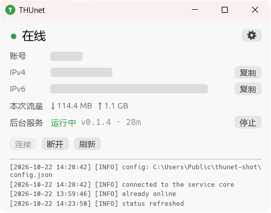
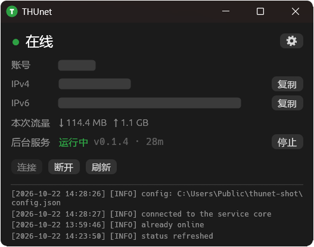
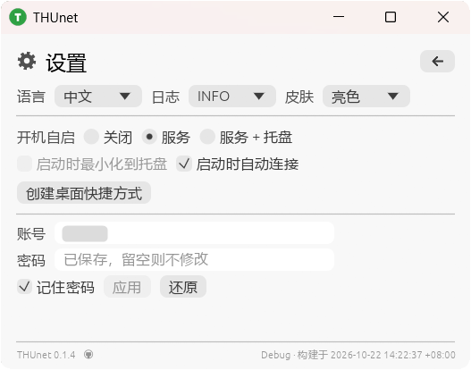
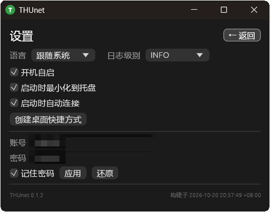
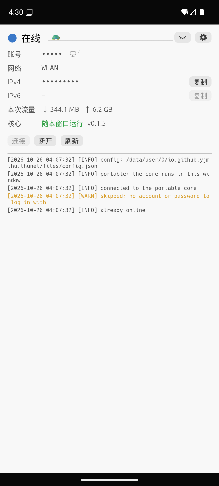
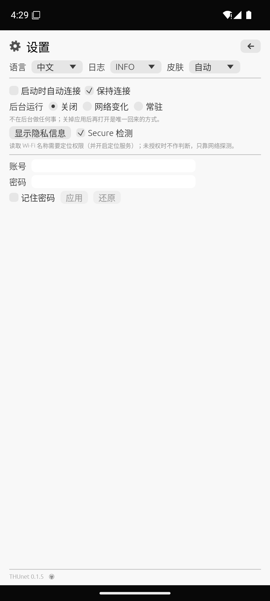
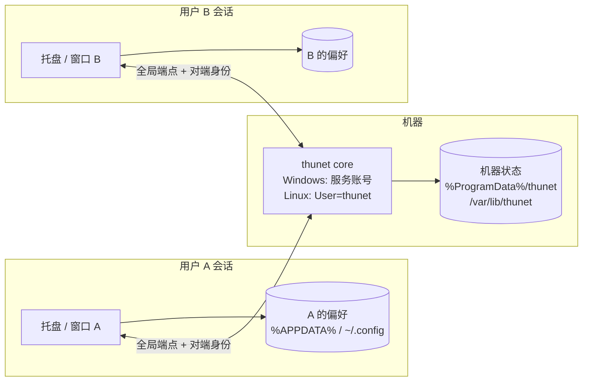

# THUnet

[English](README.md) | **简体中文**

一个跨平台的小程序：登录清华校园网（`auth4.tsinghua.edu.cn`，SRun3K 门户），并让连接一直保持在线。桌面版常驻托盘，安卓版是一个普通 APK。

桌面版只有一个可执行文件，没有运行时依赖，没有控制台窗口；可在 Windows、Linux、macOS 和 Android 上运行，界面支持中文和英文。

> **第一次使用？** 直接看 [1. 快速开始](#1-快速开始) —— 只需要 TUNET 账号和密码。协议细节在文档最后，日常使用完全不需要了解。

## 目录

**入门**

1. [快速开始](#1-快速开始)
2. [界面一览](#2-界面一览)
3. [日常操作](#3-日常操作)
4. [疑难排查](#4-疑难排查)
5. [命令行](#5-命令行)

**Android**

- [Android](#android)

**参考**

6. [数据存在哪里](#6-数据存在哪里)
7. [安装、卸载、快捷方式](#7-安装卸载快捷方式)
8. [用 winget 安装](#8-用-winget-安装)

**给好奇的人 / 开发者**

9. [网络登录到底怎么做的](#9-网络登录到底怎么做的)
10. [从源码构建](#10-从源码构建)
11. [项目结构](#11-项目结构)
12. [限制与说明](#12-限制与说明)
13. [共享机器：多用户设计](#13-共享机器多用户设计)
14. [许可证](#14-许可证)

---

## 1. 快速开始

1. **拿到可执行文件。** 推荐直接用安装包，或者自己构建（见 [从源码构建](#10-从源码构建)）：

   | 系统 | 文件 | 安装方式 |
   | --- | --- | --- |
   | Windows | `thunet-<version>-x64.msi` | 双击、`msiexec /i thunet-<version>-x64.msi`（需管理员权限，装到 `Program Files`；会弹一次或两次提权提示，见 [§7](#7-安装卸载快捷方式)），发布后也可以 `winget install --id THUnet.THUnet -e`（见 [用 winget 安装](#8-用-winget-安装)） |
   | Debian / Ubuntu | `thunet_<version>-1_amd64.deb` | `sudo apt install ./thunet_<version>-1_amd64.deb` |
   | 其他 Linux | `thunet-<version>-linux-x64.tar.gz` | 解压后运行 `./thunet`（可选 `./thunet shortcut` 生成桌面图标） |
   | Android 13+（arm64） | `thunet-<version>-arm64.apk` | 在手机上下载后点开安装（侧载，见 [Android](#android)） |

2. **运行。** 从开始菜单 / 应用菜单打开 `THUnet`，或在终端里执行 `thunet`。会弹出一个小窗口，程序做的每件事都会写到窗口底部的日志条里。
3. **打开设置。** 点窗口右上角的齿轮图标。
4. **填写账号密码。** 输入 TUNET 账号（例如 `1234567890`）和密码，勾选 **记住密码**，再点 **应用**。密码会先用随机生成的每安装密钥加密再落盘，绝不会写进设置文件；密钥和密文都由 core 持有，窗口从不读回。
5. **连接。** 回到状态页点 **连接**（如果"启动时自动连接"已经打开，等几秒即可）。标题处的圆点变成绿色就表示在线。

## 2. 界面一览

窗口只有两页，用右上角的齿轮图标切换；设置页同一位置是返回箭头。窗口出现在显示器正中，尺寸固定，所以每次启动都从同一个位置开始。

| 亮色 | 深色 |
| --- | --- |
|  |  |

*状态页，亮色与深色皮肤。*

### 状态页

| 元素 | 含义 |
| --- | --- |
| 彩色圆点 + 文字 | `在线`、`认证中` 或 `离线` |
| `账号` | 门户报告的本会话账号。右侧的角标数字是该账号在校园网上在线的设备数，点一下会弹出「校园网在线设备」列表：每台一行，带设备图标，本机那条右边带一个点；账号没有会话时不显示 |
| `网络` | 承载本机默认路由的那条链路：`以太网` / `WLAN` / `移动数据`（安卓蜂窝） / `USB 共享`（电脑通过 USB 使用手机的网络） / `未连接`。同时插网线和连 Wi-Fi 时，它说的是系统实际走的那条——会话忽然“一会儿在线一会儿离线”时先看这一行 |
| `IPv4` / `IPv6` | 本机在当前网络上持有的地址，各带一个**复制**按钮：门户有会话时显示门户报的地址，否则显示当前链路自己的地址（移动数据、其他 Wi-Fi，或还没登录的校园网）。完全没有链路时显示 `—` |
| `本次流量` | 本次会话的下载 / 上传字节数 |
| `后台服务` | 是否有 core 在应答，以及它的版本和运行时长；core 一停（例如 `thunet service stop`）就立刻变成 `未运行`。右侧按钮用于在不关闭窗口的前提下停止 / 启动服务：运行中显示 `停止`，否则显示 `启动`。便携配置下这一行叫 `核心`、内容为 `随本窗口运行`，并且没有按钮：那里 core 是窗口的一个线程，不可能比窗口活得久 |
| **连接** / **断开** / **刷新** | 手动操作，只启用当前有意义的那几个 |
| 日志条 | 最近发生的事件，最新的在最下面 |

日志长这样：

```
[2026-10-20 12:56:26] [INFO] connected
[2026-10-20 12:56:41] [DEBUG] portal: auth4.tsinghua.edu.cn
```

每个级别（`DEBUG`、`INFO`、`WARN`、`ERROR`、`FATAL`）都有自己的颜色。日志正文始终是英文 —— 它是给开发者看的诊断信息，因此不跟随*语言*设置；窗口里的其他内容都会跟随。日志条显示最新的若干行，可以滚动。

*设置 → 日志级别* 会隐藏低于所选级别的行（`DEBUG` 显示全部，然后是 `INFO`、`WARN`、`ERROR`）。隐藏只影响显示：日志并没有被丢弃，把级别调低后还会回来。

在选中的日志文本上右键可以直接复制到剪贴板。没有选中任何内容时，右键会弹出一个小菜单，包含 **复制本行** 和 **全部复制**（两者都只复制当前级别可见的内容）。在日志行上按住左键 450 ms 也会弹出同一个菜单，并且可以继续：菜单开着时再按住另一行，菜单只剩下 **复制选中的行 (n)**，复制两行之间的全部内容。在别处单击即可取消。

### 设置页

| 亮色 | 深色 |
| --- | --- |
|  |  |

*设置页，亮色与深色皮肤。*

| 设置项 | 作用 |
| --- | --- |
| 开机自启 | 三档并列一行：关闭 / 仅服务 / 服务和托盘（见 [7](#7-安装卸载快捷方式)）。不提供"只启动托盘"——托盘自己不会拉起 core，那样的图标只会一直显示"未运行"。两个平台上这一行都需要管理员权限：注册或修改服务、启停服务都是；服务已启用时，只切换托盘部分不需要提权 |
| 启动时最小化到托盘 | 和 *启动时自动连接*、*保持连接* 在同一行，并且与上面的开机自启相互独立：可以自启但隐藏，也可以手动启动时打开窗口，反之亦然。在"仅服务"档位下置灰（根本没有托盘要最小化） |
| 启动时自动连接 | 一检测到可用网络就登录。它只决定核心启动时是否想要在线，掉线之后的处理归 *保持连接* |
| 保持连接 | 会话被外部结束（被踢、超时、在门户网页上注销）后自动重新登录，直到你按 **断开**。关闭时掉线就一直是离线，且启动那次尝试是有上限的：按可用链路时间累计重试五分钟，然后停手并写一行日志 |
| 创建桌面快捷方式 | 为当前运行的可执行文件在桌面生成一个启动器（等同于 `thunet shortcut`） |
| 账号 / 密码 / 记住密码 / 应用 / 还原 | 这是唯一一行不会边输入边保存的设置：内容与已保存值不同时会变成强调色并出现 *未保存* 标记。应用会把密码加密写入 `credential.bin`（不会写进 JSON），并立刻交给正在运行的会话；如果服务未运行，应用会先请求启动服务（需要管理员），等服务应答后再写入。窗口之后不再保留副本：密码框会清空，占位文字说明已保存的值会继续生效；重新输入已保存的密码会由 core 比对（`CheckCredentials`），因此不会显示成未保存。还原会丢弃修改，恢复已保存的账号、密码和勾选状态（关闭*记住密码*时它是灰的，因为没有可恢复的内容） |
| 语言 | 跟随系统（默认）、中文、English |
| 皮肤 | 跟随系统（默认）、亮色、暗色。立即应用到窗口，并记在 `config.json` 里，下次启动沿用 |
| 日志级别 | `DEBUG` / `INFO` / `WARN` / `ERROR`：日志页显示的最低级别（默认 `INFO`，存在 `config.json` 里） |
| 版本 | 左边是版本号，右边是构建时间（本地时钟，精确到秒，并带 UTC 偏移）；前缀标明这是 `Release` 还是 `Debug` 构建，本地测试包不会和发布包混淆；版本号右侧的 GitHub 图标会打开本仓库 |

三个开关在切换后会用一个提示条确认当前状态（*开机自启：开*），因为页面上没有别的东西会随之变化。

**连接**用的是后台工作线程持有的密码：启动时是从 `credential.bin` 解出的值（必须保存过*记住密码*），之后是最后一次应用的值 —— 在点 **应用** 之前，输入框里的文字不会生效，*未保存* 标记提醒的正是这件事。因为密码只在 core 里，窗口不会把它显示回来：启动时密码框是空的，并带有「已保存，留空则不修改」的提示，*记住密码* 反映的是 core 下次启动是否还会读回这个值。取消*记住密码*并应用会删除已保存的条目，但**不会注销**：core 内存里的密码在进程退出前仍然可用。完全没有任何密码时，**连接** 会直接报告这一点，而不是向门户发送一次空登录。

**在线时点应用会替换当前会话。** 校园网一个 IP 只能有一个会话，而密码只能靠一次真正登录来证明，所以 core 会先注销、用新凭据登录；如果门户拒绝，就立刻用原账号登回去。**新凭据没被证实之前不会写 `credential.bin`** —— 这正是输错密码时机器仍能联网的原因；无论成败，连接都会中断约一秒。当 core 手里没有可回退的凭据时，应用会先弹确认框，因为密码错了机器就会离线且无凭据可登回。勾选*记住密码*时两个字段都必须填写 —— 改账号不会沿用旧密码 —— 所以没重新输入密码时应用按钮是灰的。

没有保存密码并不等于离线：客户端无论有没有密码都会向门户查询会话状态，所以已经存在的会话（今天建立的，或者本网络里另一台设备建立的）依然会显示为在线，并带有账号、地址和流量。

构建标记左边是版本，右边是编译这个二进制时的本地时间及其 UTC 偏移（`Release · 构建于 2026-10-20 19:23:23 +08:00`）。两者都是构建期嵌入的（`build.rs`），所以标记永远与正在运行的可执行文件一致 —— 当你拿不准更新有没有生效时很有用。时间是按查看者所在时区渲染的，所以同一个二进制在别的时区机器上读出来不一样；偏移量说明了当前看到的是哪个时区。前缀来自编译时的 `PROFILE`，本地调试构建会显示 `Debug`。

**不在校园网内时，连接按钮是灰的。** 登录只有在校园门户后面才能成功，所以客户端每隔几秒探测一次网络，在以下情况禁用该按钮（鼠标悬停会给出原因）：机器接在 `Tsinghua-Secure` 这类 802.1X 网络上、完全没有链路、处在别人的认证门户后面，或者已经能直接上网而不需要门户。同一句原因也会以黄色横幅常驻在状态页顶部，不用悬停就能看到；它是提示而不是错误，探测到校园门户后会自行消失。**启动时自动连接已开启但没有保存账号或密码**也走同一条黄色横幅；如果旧的门户会话还挂着，它会改成提醒“掉线后不会自动重连”——那是配置缺口，不是故障，所以不是红色。横幅最多显示三行，超出的部分用省略号截断，悬停可以看到全文。**刷新** 在任何情况下都可用；**断开** 在会话在线、或核心仍想要在线（正在重试 / 等待网络）时可用，所以它也是取消自动重连的入口。

### 托盘图标

**左键单击**托盘图标显示窗口（或把已有窗口带到前台）；**双击**把它重新隐藏。区分两者需要固定等 300 ms，所以单击会在该延迟后生效。**仅 Windows**：Linux 的托盘走 AppIndicator，不上报点击、也没有 tooltip，请在菜单里用 `显示窗口` / `隐藏窗口`，状态看窗口或日志。

便携配置在任务栏和托盘里都有标记：窗口图标是蓝色而不是绿色，托盘图标把绿/黄/灰整套换成蓝色（在线深蓝、认证中浅蓝、离线暗蓝），标题栏和 Alt-Tab 条目写 `THUnet Portable`，托盘 tooltip 也一样。白色字母在两种模式下都还是品牌 **T** —— 换一个字母只会让 16 px 的托盘图标糊成一团。

**右键**弹出菜单：`显示窗口`、`隐藏窗口`、`连接`、`断开`、`退出`。

关闭窗口只是隐藏 —— 程序继续工作。`退出` 只结束窗口和它的托盘图标，后台服务照常运行（与开机自启档位无关）；要停服务请用状态页的「停止」按钮或 `thunet service stop`。便携配置没有能在窗口之外活下来的服务——核心本身就是窗口的一个线程——但两者的生死绑在一起：关窗只是把两者一起藏起来，`退出` 才是真的结束它们。

### 提示消息

每个操作都会在窗口底部用一条彩色消息回应：**绿色**表示成功，**红色**表示失败，**蓝色**表示信息，例如"已经在线"、"已复制"，或某个开关刚切换到的状态（*开机自启：开*）。没有任何操作是静默成功的。

## Android

THUnet 也能在安卓上跑：同一个程序、同样的两个页面、同一个账号。它是普通的 APK，不上应用商店，需要你自己安装（也就是“侧载”）；安装时安卓会问一次是否允许浏览器或文件管理器安装应用。

| 状态页 | 设置页 |
| --- | --- |
|  |  |

*开启 **隐藏隐私信息** 后的安卓界面，账号和地址都显示为圆点。*

### 安装

1. 在手机上下载 `thunet-<version>-arm64.apk`（需要 Android 13 及以上，且是 arm64 手机）并点开。
2. 安卓询问时允许浏览器或文件管理器安装应用，然后点 **安装**。
3. 打开 THUnet，点齿轮，填 TUNET 账号和密码，勾选 **记住密码**，点 **应用**。
4. 回到状态页点 **连接**；如果开着 **启动时自动连接**，下次打开就会自己连上。

系统的返回手势等同于右上角的箭头：先收起展开的菜单、设备列表或确认框，再从设置页回到状态页，最后才把应用退到后台。

### 后台留多少

**后台运行**这一行是桌面版“开机启动”的对应物，顺序也一样：

| 级别 | 含义 |
| --- | --- |
| 关闭 | 后台什么都不留。把应用划掉，会话就结束，只能重新打开。 |
| 网络变化 | Wi-Fi 变化时唤醒并登录，通知栏里没有任何东西；其余情况由 15 分钟一次的后台任务兜底。 |
| 常驻 | 前台服务 + 静默通知：从最近任务里划掉后会话仍在线，开机也会自启动。第一次会申请通知权限。 |

**保持连接**是另一回事，语义和桌面版一致：会话掉线后 core 要不要自己重新登录，与“后台留什么”无关。

“网络变化”和“常驻”下面还有一行 **允许后台唤醒**。系统默认会限制应用的后台电量，同时**封锁它在后台的网络**——被封锁时连域名都解析不了，唤醒后也登录不上，日志里表现为“门户没有应答 / 离线”。点 **去设置** 会先弹出系统的电量限制对话框，答完返回后自动跳到系统的应用信息页，厂商的“自启动”和“省电策略”都在那里；这两项应用读不到，所以用一个勾选框让你确认。状态行会如实显示系统电量限制是否已解除。

### 需要知道的

- **通知。** 只有“常驻”会显示通知；它静音、低优先级，按钮可以断开连接或退回“网络变化”。登录失败只写进日志，不会进通知栏。
- **Secure 检测。** 默认关闭，开关在“隐藏隐私信息”右边：读取 Wi-Fi 名称来识别 `Tsinghua-Secure`，识别到就跳过门户。读 Wi-Fi 名称需要定位权限，勾选时系统会申请；不授权就只用网络探测，不做判断。
- **密码管理器。** 账号和密码框由应用自己绘制，但已经登记到安卓的自动填充里，Bitwarden 等应用可以弹出下拉框来填充，也能提示保存。
- **省电策略。** 部分厂商（MIUI、EMUI、ColorOS 等）会积极清理后台，而且默认还会限制后台应用的网络。按上一节点“去设置”解除电量限制、并允许自启动之后，“网络变化”和“常驻”才真正可用；而“强行停止”永远有效，直到你重新打开应用。
- **桌面快捷菜单。** 长按桌面上的 THUnet 图标，可以直接选 **连接 / 断开**：不打开界面，只弹一条结果提示；应用没在运行时也会临时启动完成这一次请求。
- **更新。** 下载新的 APK 覆盖安装即可，设置和已保存的密码都会保留——前提是签名密钥相同。debug 包和 release 包密钥不同，两者互换要先卸载。
- **只支持 arm64。** 发布包只有 `arm64-v8a`，更老的 32 位手机装不上。

## 3. 日常操作

**启动服务** —— 窗口不会自己拉起后台服务：`后台服务` 一行显示 `未运行` 时，点它右边的 **启动**（或执行 `thunet service start`）。Windows 上如果服务还没注册，**启动** 会先注册服务（一次管理员授权），再让 SCM 启动它，不会另起一个用户进程。在服务重新应答之前，状态页顶部会一直有一条红色横幅说明这一点。**停止** 会结束整机服务，但窗口保持打开。

唯一的例外是便携配置（`--state-dir` / `THUNET_STATE_DIR`）：两个平台行为一致，而且那里没有机器服务——核心默认是窗口的一个线程，也可以单独起一个进程。状态页的 `核心` 一行两种都能起停；`thunet service start|stop|restart` 在终端做同样的事（起停该状态目录的 core 进程，已打开的窗口会自动 attach），`service enable|disable|status` 则管本窗口自己的登录条目。只有 `install` / `uninstall` 被拒绝——要操作机器服务用 `thunet --machine service …`。提便携配置就是提它的目录：裸 `thunet` 是机器模式。

**登录与注销** —— 用状态页的按钮、托盘菜单，或者 `thunet login` / `thunet logout`。如果会话已经存在，客户端会直接告诉你，而不是重复认证。

**查看地址** —— 在线时 IPv4/IPv6 行每 15 秒自动刷新。点 **复制** 会出现一条确认提示。

**不显示窗口也要保持在线** —— 关掉窗口即可。托盘图标保留，日志继续记录，每 5 分钟向校园主页发一次请求来保持会话。

**开机自启** —— 设置 → *开机自启*。如果希望启动时窗口保持隐藏，同时打开 *启动时最小化到托盘*（自启项随后会带上 `--minimized`）。两个平台上服务部分都会要求一次管理员授权：后台 core 是整机服务，不是每用户进程。托盘部分是每用户的。

**切换语言** —— 设置 → *语言*。选择会存进配置文件并立即生效。

## 4. 疑难排查

| 现象 | 处理办法 |
| --- | --- |
| 日志出现 `login rejected` / `E2901` | 密码错误。在设置里重新输入，再次勾选*记住密码*并点 **应用**。 |
| 日志出现 `E2808 Control policy not found` | 门户返回了非预期的接入控制器编号。客户端通常能自动探测；在需要认证的 Wi-Fi 上只能靠猜。重连校园 Wi-Fi 后点 **刷新**。 |
| 日志出现 `E2553` | 该账号已在别处在线（手机、另一台电脑）。先在那里注销。 |
| 能上网但看不到会话 | 你在 `Tsinghua-Secure` 或其他 802.1X 网络上，这里不需要门户登录 —— 客户端按设计保持空闲。 |
| 点 **连接** 没反应 | 看日志条。机器完全没有链路时，客户端会等 30 秒再重试。 |
| 横幅提示后台服务是旧版本 | 窗口和服务来自不同的构建：安装替换了文件，但旧服务进程一直在跑。点 `后台服务` 一行的 **重启**（一次管理员授权），或执行 `thunet service restart`。 |
| **连接** 是灰的 | 客户端判断这里登录不会成功（`Tsinghua-Secure` 这类 802.1X Wi-Fi、无链路、别人的门户，或已经能上网）。悬停按钮可看到具体原因；**刷新** 仍会查询门户。 |
| **连接** 提示 `No account or password saved` | 没有任何可用于登录的凭据：在设置里输入密码并点 **应用**。客户端不会向门户发空登录。 |
| 日志出现 `the new credentials were not accepted` | 切换账号被门户拒绝。原账号会自动登回，已保存的凭据没有被改动，所以机器仍在线上；重新输入密码再应用，或点 **还原** 放弃这次修改。 |
| 窗口不见了 | 在托盘里。点托盘图标（或用菜单里的 `显示窗口`）。 |
| 程序崩溃了 | 看 `config.json` 同目录下的 `crash.log`（见 [数据存在哪里](#6-数据存在哪里)）。程序没有控制台，这个文件是唯一记录。 |
| 在 PowerShell 里命令没有输出 | 二进制没有控制台，PowerShell 不会等它。用 `cmd /c thunet status` 或 `Start-Process -Wait thunet`。 |

## 5. 命令行

窗口是默认模式；所有子命令都是可选的，同一个可执行文件兼顾两者。

```
thunet                       # 托盘 + 窗口（等同于不带参数）
thunet --minimized           # 启动后隐藏在托盘
thunet core                  # 后台服务：真正持有网络会话
thunet service <action>      # install/uninstall/enable/disable/start/stop/restart/status
thunet quit                  # 让运行中的窗口退出，并等到它真正消失
thunet status                # JSON：服务自身状态 + 门户会话/流量
thunet login                 # 认证：stdin 三行、-i 提问，--cmd/--bash 打印该敲的命令
thunet logout                # 让服务注销
thunet ac-id                 # 服务正在使用的门户 ac_id
thunet config                # core 的生效设置；--auto-connect/--keep-online/--remember-password on|off
thunet shortcut              # 创建桌面快捷方式
thunet completions <shell>   # 输出 bash/zsh/fish/elvish/powershell 补全脚本
thunet selftest              # 注意：真正的测试向量在 `cargo test` 里
```

Windows 上 MSI 把可执行文件放在 `C:\Program Files\THUnet\bin`，并把该目录追加到系统 `PATH`，所以安装之后新开的终端里可以直接用 `thunet`；`.deb` 装的是 `/usr/bin/thunet`。

`thunet config` 向运行中的 core 要它的生效设置——门户主机、`ac_id`、账号、`has_password`、`remember_password`、`auto_connect`、`keep_online`——并打印保存其余字段的文件路径（`core.json`；`https`、`ip`、重连延迟没有界面也没有开关）。它完全不读窗口的文件。`--auto-connect on|off`、`--keep-online on|off`、`--remember-password on|off`（别名 `--remember-pwd`）是设置页那三个开关的 CLI 形式：它们发给 core —— core 才是执行这些设置、并且唯一有权写入它们的进程。`--remember-password off` 会删掉 core 保存的密文，和取消勾选*记住密码*完全一样，回答直接取自 core 的 `CredentialState`，所以服务必须在运行。

补全脚本由解析器使用的同一份 `clap` 定义生成，所以每个子命令（含 `service <action>`）和每个全局参数都能补全：

```
thunet completions bash > ~/.local/share/bash-completion/completions/thunet
thunet completions zsh  > ~/.zfunc/_thunet        # 需配合 fpath=(~/.zfunc $fpath)
thunet completions fish > ~/.config/fish/completions/thunet.fish
```

`.deb` 已经把 bash、zsh、fish 的补全装到 `/usr/share` 下，所以在 Debian/Ubuntu 上 `apt install` 之后无需任何配置即可生效。

窗口只是一个**前端**。网络会话住在 `thunet core` 里，两者通过本地套接字通信（Windows 上是命名管道）。窗口不会自己拉起 core：它来自开机自启、`thunet service start`，或者状态页的「启动」按钮。所以关掉窗口不会掉线，而且只有 core 这一半能在开机时起——Linux 是 systemd **系统**单元，Windows 是一个真正的 **服务**，都由设置页的「随系统启动」注册。两个平台上注册、启动和停止服务都需要管理员权限。

`status`、`login`、`logout`、`ac-id` 同样是前端：它们通过同一个套接字请求正在运行的服务，而不是自己连门户，所以会话始终只有一个持有者。服务没在跑时它们直接报错，并提示该用哪个命令启动——**绝不会**退回自己去开第二个连接。

`thunet login` 有两种拿到账号密码的方式：往 stdin 写三行（什么都不问），或者用 `-i`（在控制台上依次提问）。两者都不用时，它只用服务已保存的那一对连接。账号密码永远不来自参数；三种情况下报告都一样，只是第一行说明账号从哪来：`account: alice (stored)`、`account: alice (stdin, remember yes)` 或 `account: alice (asked)`。

三行分别是什么、留空代表什么：

1. 账号——留空则沿用 core 当前持有的账号；
2. 密码——留空则沿用 core 当前持有的密码；
3. 是否记住——默认「保存」。只有明确写 `n`、`no`、`0` 或 `false` 才跳过保存，而这同时会删掉之前保存的那份：和窗口里取消勾选*记住密码*是同一个动作。

第 3 行默认「保存」是有意的：绝大多数人就是想把密码存下来，而且在线时 core 会先把这一对证明给对方看再落盘，门户拒绝时它会退回原来那份凭据。离线时没有东西可证明，这一对会先存下来，等网络恢复后再用。

不加 `-i` 时任何平台都不会提问：Windows 上的可执行文件是 GUI 子系统的程序，本身不拥有控制台，而它附加的那个控制台正被 shell 同时读取——回车会被 shell 自己的行编辑器吃掉，答案会被两边分掉。这就是默认走管道的原因，也是 `-i` 的含义：你明确承诺有一个 shell 正在等着回答。

`-i` 把这同样三件事问出来而不是读出来：账号（已保存的账号作为默认值，回车即沿用）、密码（不回显，回车则沿用服务当前持有的那个）、是否记住——`[Y/n]`，回车表示「是」，只有 `n`、`no`、`0` 或 `false` 表示「否」，而「否」还会删掉之前保存的那份——再加一个管道带不了的问题：服务是否在启动时自动连接（`Connect automatically at startup? [Y/n]`，默认「是」；管道仍然只有三行，所以脚本不会悄悄改掉它没看见的设置）。任何一步按 Ctrl+C 都会取消：终端恢复原样，进程以 130 退出。stdin 是什么，答案就从哪里来：接的是管道，答案就是那三行；那里没有任何可用输入时，问题会立刻失败而不是一直等下去。这个承诺没有任何东西替你检查。

这个承诺在哪些 shell 里成立，取决于 shell 而不是平台：

| Shell | 该敲的命令 |
| --- | --- |
| `cmd.exe`、PowerShell 5.1 / 7 | `cmd /c thunet login -i` |
| bash、zsh、sh、fish（Linux、macOS，以及 Windows 上的 Git Bash） | `thunet login -i` |

交互式 `cmd.exe` 和 PowerShell 在启动一个 GUI 子系统程序之后立刻回到自己的提示符，会把答案抢走；`cmd /c` 会把这一行剩下的部分当成命令执行，而 cmd 会等它的子进程。bash 和 POSIX 系列在所有平台都等待前台子进程（Git Bash 也一样），所以那里 `-i` 不需要前缀。Git Bash 有两个细节：单个斜杠的开关会被当成路径，所以在那里敲 `cmd /c` 只会把 cmd.exe 单独启动起来（请用不带前缀的写法，或者确实要用 cmd 时写 `cmd //c`）；如果终端给原生程序的是管道而不是控制台，答案就只能从那条管道喂进去。

`thunet login --cmd`（别名 `--pwsh`）打印 Windows 那一行，`thunet login --bash`（别名 `--zsh`、`--sh`、`--fish`）打印 POSIX 那一行，所以手边有终端时不必翻这一页。两者都只打印一行、别的不打印——问题本身由 `-i` 提出，所以不再需要逐 shell 的粘贴块。

脚本仍然可以把三行喂给 stdin，完全不依赖 shell：

```bash
printf 'alice\npw\ny\n' | thunet login
```

密码从不进入 `argv`，也不进入 shell 历史：它只会从控制台或那条管道读取，所以任何进程列表里都看不到它。`thunet login --help` 是这套说明的短版本，`thunet login -v` 是长版本，附带两条命令背后的原因。

这个命令从不沉默。它先说明打算用哪个账号、这个账号从哪来——直接运行是 `account: alice (stored)`，接了管道则是 `account: alice (stdin, remember yes)` 或 `(stdin, remember no)`，用 `-i` 问出来则是 `account: alice (asked)`——然后打印服务状态，core 持有账号时会一并写出（`session: online as bob`、`session: authenticating as alice`、`session: offline (credential: alice)`，或者干脆只有 `session: offline`）。用 `-i` 时紧跟一行 `auto connect: on` 或 `off`，说明下一次启动会怎么做。每次运行还会报告自启动状态，写出负责启动的条目；关闭时会附上打开它的办法：

```
account: alice (stdin, remember yes)
session: offline (credential: bob)
autostart: disabled (thunet.service)
  turn it on with `thunet service enable` (asks for administrator rights)
credentials: alice, saved for the next start
online
```

机器模式写的是服务（Linux 是 `thunet.service`，Windows 是 `thunet` 服务）；便携窗口写的是它自己的登录条目（`thunet-portable-<tag>.desktop`，或计划任务 `thunet-portable-<tag>-tray-<user>`），因为它没有服务可指，提示指向设置页的*登录时启动本窗口*。

接了管道或用了 `-i` 时，在登录结果之前一定会有 `credentials:` 这一行（`saved for the next start`、`this session only`，凭据不完整时是 `NOT saved`）。直接运行且服务已经用同一个账号在线时，它打印 `nothing to change`：既不发送凭据变更，也不再尝试登录。完全没有账号时（新机器、没有接管道也没用 `-i`），它会报错，提示把三行接进管道（或者用 `-i`），并指向 `thunet login --help`。

`thunet status` 输出一个对象，两半都在：

```json
{
  "core":   { "version": "0.1.5", "build_epoch": 1792571000, "pid": 1234,
              "uptime_secs": 812,
              "state": "Online", "env": "Campus", "ac_id": "169",
              "host": "auth4.tsinghua.edu.cn",
              "credential": { "username": "1234567890", "has_password": true,
                              "remembered": true, "revision": 2, "matches": null },
              "auto_connect": true, "keep_online": true,
              "wanted_online": true, "autostart": true, "failures": 0, "frontends": 1,
              "endpoint": "/run/user/1000/thunet/control.sock" },
  "portal": { "error": "ok", "online_ip": "…", "bytes_in": … }
}
```

`core` 描述服务自身（`uptime_secs`、`env` 里的网络判定、当前接入的 frontend 数）。门户查询失败时 `portal` 为 `null`、原因在 `portal_error` 里，命令以非零退出。

在已经运行时再次启动 `thunet` **不会**启动第二个副本：只会把已有窗口带回前台。

全局覆盖参数：`--host <host>`、`--http`、`--timeout <secs>`、`--ip <addr>`、`--ac-id <id>`。

优先级是 **命令行 > core 的文件 > 凭据存储**。`--host` / `--http` / `--timeout` / `--ip` / `--ac-id` 作用于一次性的命令，也作用于便携模式的 core（`thunet --host … core`），所以拿假门户做测试才可行；机器服务和窗口只从 `core.json` 读设置，而账号和密码从不来自命令行：`thunet login` 从 stdin 读取它们。

密码根本没有 `argv` 形式：它只会从 stdin 读取，所以不会出现在 shell 历史和进程列表里（Linux 的 `/proc/<pid>/cmdline` 对其他用户可读，除非 `hidepid=2`）。

## 6. 数据存在哪里

现在有两个目录：窗口的每用户偏好，以及 core 的整机状态。

| | 每用户（窗口） | 整机（core） |
| --- | --- | --- |
| Windows | `%APPDATA%\thunet\` | `%ProgramData%\thunet\` |
| macOS | `~/Library/Application Support/thunet/` | 与每用户相同（无服务） |
| Linux | `$XDG_CONFIG_HOME/thunet/`（通常是 `~/.config/thunet/`） | `/var/lib/thunet/`，权限 `0700`，属主是服务用户 |

每用户文件：

| 文件 | 内容 |
| --- | --- |
| `config.json` | 语言、日志级别、主题、隐私开关、启动时最小化。只属窗口：账号和会话策略归 core。 |
| `crash.log` | 仅在窗口 panic 时追加。 |

整机文件：

| 文件 | 内容 |
| --- | --- |
| `core.json` | 账号、门户主机、`https`/`ac_id`/`ip` 覆盖、*启动时自动连接* / *保持连接* 两个开关、重连延迟，以及下次启动是否读回加密凭据。**没有密码。** |
| `credential.bin` | 加密保存的账号密码，权限 `0600` / 仅服务 ACL。 |
| `key.bin` | 随机 32 字节数据密钥，权限 `0600` / 仅服务 ACL。 |
| `core.log` | 后台 core 的诊断日志。 |

密码存储在所有平台上只有一套实现：`credential.bin` 里是 `MAGIC "THUNET-1" ‖ nonce ‖ 密文`（ChaCha20-Poly1305），权限 `0600`，密钥是 `key.bin` 里的**随机 32 字节**，从不由机器标识派生。没有旧格式兼容：magic 不是 `THUNET-1` 的文件一律当作不存在。

窗口从不打开 `core.json` 或凭据文件：它发送 `SetCredentials`，只拿回 `{ username, has_password, remembered }`，从不接触密码。`remembered` 由 core 记在自己的 `core.json` 里，所以服务重启后仍能读回密文。这样每个交互用户都能改共享凭据，却读不到它。

真正起作用的边界是目录 ACL，不是加密：

- Windows：`%ProgramData%\thunet` 使用显式 DACL 并关闭继承，只授予服务 SID、`SYSTEM` 和 Administrators。
- Linux：`StateDirectory=thunet` 以 `0700` 创建 `/var/lib/thunet`，属主是动态服务用户。

如果整盘镜像把 `key.bin`（以及 Linux 上的 systemd host key）也带走了，仍然可以解密；只有 TPM 绑定密钥或口令能改变这一点。管理员/root 无论如何都能读密钥或 dump core 的内存。

删除每用户目录只会重置窗口偏好；删除 `core.json` 重置 core 的设置（密文里仍有账号，下次启动会恢复）。拆分前的旧版本把两个主人放在同一个 `config.json` 里：首次启动会就地拆分——core 那一半搬到 `core.json`，机器目录里的旧文件直接删除。整机目录属于服务，升级和重装后仍在，真正的卸载会连同 `credential.bin`、`key.bin` 一起删除。

## 7. 安装、卸载、快捷方式

**THUnet 的安装与卸载只由操作系统负责** —— Windows 上是 `.msi`，Debian/Ubuntu 上是 `.deb`。程序本身从不复制文件、不写卸载项；它唯一会注册的东西是自启（托盘的登录任务、core 的服务），而且只在你主动开启时才注册。没有"为我安装"按钮，也没有 `thunet install` 命令。这样每次安装只有一个所有者，不会出现两份注册信息争抢同一批文件。

| 系统 | 安装后的可执行文件 | 注册信息（由安装包创建） |
| --- | --- | --- |
| Windows | `C:\Program Files\THUnet\bin\thunet.exe` | *设置 → 应用* 里的 Windows Installer 条目、整机开始菜单里的 `%ProgramData%\Microsoft\Windows\Start Menu\Programs\THUnet`、每用户桌面快捷方式，以及追加到系统 `PATH` 的 `C:\Program Files\THUnet\bin` |
| Linux | `/usr/bin/thunet` | `/usr/share/applications/thunet.desktop`、`/usr/share/icons/hicolor/scalable/apps/` 下的图标，均为整机范围 |

MSI 是每机器安装（`Scope="perMachine"`），一次 UAC 换来的是：安装包拥有机器级状态，所以它能在替换文件前停掉 core 服务、卸载时删除它——而每用户的包以普通权限运行，两件事都做不到，只能留下一个指向已删除 exe 的服务条目。代价是安装、升级和卸载都需要管理员授权。开始菜单条目同样是整机的（在 `CommonAppDataFolder` 即 `%ProgramData%` 下逐级写出路径）：WiX 的 `ProgramMenuFolder` 会解析成运行安装程序那个用户的配置目录，每机器安装就会在旁边多出一份只属于该用户的副本。

**会遇到几次提权提示。** 整个事务里有两处需要管理员权限，而它们是分别申请的。每机器的安装事务由安装程序自己提权；关掉所有窗口并停掉正在运行的 core 是另一回事：`QuitAllWindows` 是 immediate 自定义动作，跑在 msiexec 的*客户端*进程里，而双击启动时那个进程是未提权的——它会去调用 `thunet --machine quit --all-sessions`，由后者申请机器级信号和服务 DACL 只留给管理员的那部分权限。从已经提权的上下文启动安装包，则在最开始就把这个令牌交给了客户端，第二次提示根本不会出现：

| 启动方式 | 全新安装 | 重新安装、升级、卸载 | 静默（`/qn`） |
| --- | --- | --- | --- |
| 资源管理器双击 | 1 次 | 2 次 | — |
| 右键*以管理员身份运行*、管理员终端、winget | 1 次 | 1 次 | 1 次 |
| 普通终端 | — | — | 失败（1925：静默安装无法申请提权） |

第二次提示不是错误，也不是第二次安装：拒绝它会中止事务并整体回滚，接受它则让同一次安装继续下去。它之所以存在，是因为普通交互用户对服务只有*查询*权限——启动和停止始终只属于管理员——所以代价是多一次确认，而不是让任何登录用户都能停掉后台 core。如果不想看到它，请从提权的上下文启动安装包；另一条路是 `Privileged` 属性，它让 msiexec 客户端自己提权，代价是整个安装界面都在管理员权限下运行。

窗口偏好是**每用户**的（`%APPDATA%\thunet`），而 core 的账号、门户主机和加密凭据在整机目录（`%ProgramData%\thunet`）。服务由应用在第一次选择服务档位或第一次点状态页的 **启动** 时注册（需要管理员），而不是由 MSI 直接创建；MSI 在升级时会停掉、改写路径并重启它。

程序运行时卸载是安全的：安装包会先通过应用自己的退出命令（`thunet --machine quit --all-sessions`，隐藏执行）让窗口自己退出。它举起的是一个机器级信号，不需要 core 在运行——其他会话、其他用户账号下的窗口会轮询到并自行结束；安装步骤本身没有管理员权限时，这条命令会通过 UAC 请求提权。每个窗口会回自己的 session 以及“打开还是托盘”的状态，提权方把它写进机器目录。直接关窗只会隐藏，强杀又会跳过正常退出。随后同一个命令通过 Service Control Manager 停止服务（`ControlService`，并等进程真正消失），并把「停之前是否在跑」记下来；这些都发生在任何文件被替换之前，而且**不启动任何外部程序**，所以不会闪出控制台窗口。真正的卸载随后删除服务、删除整机目录（`%ProgramData%\thunet`，含 `credential.bin`、`key.bin`），最后才删除文件、快捷方式、开始菜单文件夹和安装目录。主版本升级同样会停服务，但保留注册和整机状态，并把注册的镜像路径改到刚装上的可执行文件——这样换了安装位置也不会让 SCM 去启动旧路径；托盘登录任务则在下次启动时重写。升级或重装时，一个 commit 动作（SYSTEM 权限，且只在事务成功时执行）会执行 `thunet --machine service-restore`：停服务时记录为「在跑」就先拉起 core，再读取窗口记录、按 session 用 `CreateProcessAsUser` 启动 `thunet.exe --visible` 或 `--minimized`，所以恢复出来的窗口保持原来的状态。

第一次安装时，**交互式**安装（UILevel ≥ 4）会在事务结束后启动程序。启动走的是桌面外壳自己的 `ShellExecute`（WiX util 扩展的 `WixUnelevatedShellExec`），托盘拿到的是用户自己的令牌，而不是安装程序的提权令牌；早先让它去调用 `explorer.exe`，在部分机器上会弹出资源管理器窗口而不是启动程序。静默的第一次安装（`msiexec /qn`、winget）不会启动任何东西，因此不会抢占桌面。升级或重装不走这条路：被关掉的窗口会从记录里恢复（见下文），因此不会重复启动，原本没在运行窗口的机器也保持安静。

`.deb` 通过 `prerm` / `postinst` 做同一件事。`prerm` 以 root 身份执行同一个退出命令，所以不涉及授权提示；每个机器模式窗口在收到机器级信号后，直接在**同一条连接**上应答（uid 由内核通过 `SO_PEERCRED` 报告），提权方把这些应答写到 `/run/thunet-quit-record`，随后停掉 core，并把「当时是否在跑」写进 `/run/thunet-core-was-running`。升级或重装时，`postinst` 只执行一条 `thunet --machine service-restore`：标记说它在跑就先把 core 拉起来，再读取窗口记录并通过用户自己的 systemd 管理器启动窗口（`systemd-run --user --machine=<用户>@.host … thunet --visible`/`--minimized`），这样图形会话的 `DISPLAY` / `WAYLAND_DISPLAY` 自然沿用，安装脚本不需要自己猜。没有登录的用户会被跳过，便携窗口从不记录。交互式安装和静默安装行为一致：core 原来在跑就恢复，窗口按退出前的状态恢复——原来隐藏的留在托盘，原来打开的重新显示。

开机自启的注册按平台分工，但规则一致：**装包不会注册任何会自动运行的东西**。Linux 包安装系统单元但保持未启用；Windows 上服务在应用创建之前根本不存在。core 在第一次选择服务档位或第一次点 **启动** 时才注册（需要管理员），托盘条目始终是每用户的。升级会沿用之前的状态，判据是「当时是否在跑」：机器级退出会停 core 并把状态记下来，恢复窗口的同一个 `service-restore` 只在这种情况下重新拉起它。这里不看开机自启：用户手动启动过的 `demand` 服务 / 未启用的 systemd 单元也会恢复，而开了自启但被用户停掉的则保持停止。状态都直接从系统读回来，不写进 `config.json`。条目有两个（托盘、后台服务），模式有三档：

| 模式 | Linux | Windows |
| --- | --- | --- |
| **关闭** | 不注册任何条目 | 不注册任何条目 |
| **仅服务** | 启用 systemd **系统**单元 `thunet.service`，开机即起，早于任何人登录 | `thunet` **服务**（虚拟账号 `NT SERVICE\thunet`，启动类型 `auto`）：登录界面出现前就已在线，没有托盘图标 |
| **服务和托盘** | 单元 + `~/.config/autostart/thunet.desktop` | 该服务 + 每用户 `thunet-tray-<用户>` 登录任务 |

没有提供"只启动托盘"：托盘自己不会拉起 core，单独一个图标只能一直报"未运行"。

| 系统 | 自启项 |
| --- | --- |
| Windows | core 是一个 **服务**（`thunet`，虚拟账号 `NT SERVICE\thunet`，`SERVICE_WIN32_OWN_PROCESS`），由服务控制管理器在开机时拉起——比任何人登录都早，这是登录任务做不到的。状态在 `%ProgramData%\thunet`。托盘仍是每用户登录任务（`thunet-tray-<用户>`，无延迟、`InteractiveToken` + `LeastPrivilege`），这也是定位权限还能用的原因。注册、启动和停止服务都需要管理员权限。 |
| Linux | 托盘：`~/.config/autostart/thunet.desktop`，由桌面会话自己启动（XDG autostart），所有桌面都认；后台服务：systemd **系统**单元（`DynamicUser=yes`、`StateDirectory=thunet`），注册、启动和停止都需要管理员权限（pkexec/polkit）。 |
| macOS | 由 `auto-launch` crate 管理的 LaunchAgent；core 本身用 `thunet core`、`thunet service start` 或状态页的「启动」按需拉起。 |

安装包自带系统单元；便携安装可以用 `thunet service install`（管理员）写入。`systemctl start|stop|status thunet` 不用进设置页就能用。`thunet service <action>` 把两个平台包成同一套动词：

| 动作 | Linux | Windows |
| --- | --- | --- |
| `install` / `uninstall` | 写入 / 删除系统单元 | 创建 / 删除服务，需要管理员 |
| `enable` / `disable` | 挂进开机路径 | 把启动类型设为 `auto` / `demand`，需要管理员 |
| `start` / `stop` / `restart` | `systemctl …`，需要管理员 | `StartServiceW` / `ControlService`，需要管理员 |
| `status` | `systemctl status` | `QueryServiceStatusEx` + `QueryServiceConfig` |

core 一旦注册，就属于 systemd / 服务控制管理器管：窗口只会重连它，绝不在后台自己再 spawn 一个。`enable` / `disable` 只决定**下次开机**是否自动起，不改变当前是否在运行 —— 那是 `start` / `stop` 的事。便携模式（`THUNET_STATE_DIR`）下没有机器服务可操作：`enable`、`disable`、`status` 作用于本窗口自己的登录条目（「登录时启动本窗口」的 CLI 版），`start`、`stop`、`restart` 起停该状态目录的 core（独立进程，已打开的窗口会 attach 上去），只有 `install` / `uninstall` 被拒绝；要操作机器服务，用 `thunet --machine service …` 显式指明。

Linux 上服务由安装包提供，`thunet service start|stop|status` 立刻可用；便携安装需要先执行 `thunet service install`（管理员）。Windows 上服务由第一次选择服务档位、第一次点 **启动**（或 `thunet service install`）创建，之后 `start|stop|status` 都需要管理员授权。

剩下的唯一自助操作就是桌面快捷方式：设置页的 **创建桌面快捷方式**，或 `thunet shortcut`，它会为当前运行的可执行文件在桌面生成启动器（Linux 上还会把 `.desktop` 标记为可信，以便 GNOME 直接启动）。

卸载：Windows 上 *设置 → 应用 → THUnet → 卸载*，Debian/Ubuntu 上 `sudo apt remove thunet`。`%APPDATA%\thunet` 里的窗口偏好会保留；整机状态（`%ProgramData%\thunet`，含 `credential.bin`、`key.bin`）会在真正的卸载时删除，升级/重装则保留。Windows 上卸载不需要提前准备：安装包会结束托盘与 core 服务、删掉注册（服务和本用户的 `thunet-tray-<用户>` 登录任务），并移除 `PATH` 条目。`.deb` 的 `prerm` 会执行同一个 `thunet --machine quit --all-sessions`，所以即使 core 已经停掉，窗口也会在文件被替换前退出；便携窗口不受影响，它属于某个状态目录，而不是整机服务。

## 8. 用 winget 安装

只要存在对应的清单，winget 就能安装 THUnet。从"只给我自己用"到"所有人都能装"，分三个层次：

### 8.1 已发布（什么都不用做）

清单合并进社区仓库后，只需要：

```
winget install --id THUnet.THUnet -e
winget upgrade --id THUnet.THUnet -e
winget uninstall --id THUnet.THUnet -e
```

### 8.2 用本地清单安装（不发布）

本仓库会在 MSI 旁边生成清单：

```
pixi run -e package winget         # -> dist/winget/*.yaml
```

然后**在提权的终端里**（该功能默认关闭）：

```
winget settings --enable LocalManifestFiles
winget validate --manifest dist\winget
winget install --manifest dist\winget
```

生成的 `InstallerUrl` 指向一个必须存在的 GitHub Release；用 `-BaseUrl` 改它：

```
pwsh -File scripts/winget_manifest.ps1 -BaseUrl https://github.com/<you>/thunet/releases/download/v<version>
```

### 8.3 发布出去，让任何人都能 `winget install THUnet.THUnet`

1. 把 `dist/thunet-<version>-x64.msi` 上传到 Release；保持资产名稳定 —— 清单里的 hash 必须与字节完全一致。
2. 用真实的 `-BaseUrl` 重新生成清单，让 `InstallerSha256` 与上传的文件一致。
3. 提交清单，可以用 [`wingetcreate`](https://github.com/microsoft/winget-create)：`wingetcreate submit --token <GitHub PAT> dist/winget`，或者直接向 [microsoft/winget-pkgs](https://github.com/microsoft/winget-pkgs) 提 PR，在 `manifests/t/THUnet/THUnet/<version>/` 下加入三个 YAML 文件。
4. 自动验证通过、PR 合并后，`winget search THUnet` 就能找到这个包，安装/升级/卸载与 8.1 一致。

社区仓库会检查：安装包 URL 必须是公开 HTTPS、SHA256 必须匹配、必须能**静默**安装 **和**卸载（`/qn`，MSI 已满足），`Publisher` / `PackageName` 要与安装包写进 *已安装的应用* 的值一致（`THUnet contributors` / `THUnet`）。

以下两处只服务于安装验证步骤，删掉它们会让 `Validation-Executable-Error` 标签回归：

- `packaging/thunet.wxs` 通过 `ARPINSTALLLOCATION` 让 *已安装的应用* 记录 `InstallLocation`；MSI 自己从不写这个值，没有它就无法定位已安装的可执行文件。
- `scripts/winget_manifest.ps1` 把 `thunet.exe` 声明为 `InstallationMetadata` 的 `launch` 文件，并带上 `InvocationParameter: --version`。THUnet 是托盘客户端：不带参数启动会一直驻留到用户退出，对任何"执行已安装二进制"的检查来说都像是卡死或失败。`--version` 会打印版本并在远小于一秒内以 0 退出。

> 一个版本的产物必须先可访问才能发布清单，所以请**先**上传 Release，再开 PR。

步骤 1–3 由 [`.github/workflows/release.yml`](.github/workflows/release.yml) 自动化：推送与 `Cargo.toml` 一致的标签（`git tag v0.1.1 && git push origin v0.1.1`），工作流会构建 MSI、连同生成的清单一起发布，并在配置了 `WINGET_TOKEN` secret （带 `public_repo` 的 classic PAT）时自动向 `winget-pkgs` 提 PR。

## 9. 网络登录到底怎么做的

全部是对门户的普通 HTTP(S) 请求 —— 没有浏览器，也没有 JavaScript。完整流程在 **[docs/protocol.md](docs/protocol.md)** 里：网络探测、`ac_id` 发现、challenge token、`{MD5}` / `{SRBX1}` 编码、校验和、会话校验、状态轮询以及门户错误码。

实现位于 `src/srun.rs`（协议）和 `src/session.rs`（状态机）；`src/crypto.rs` 里是 MD5/SHA-1/XXTEA。使用这个程序不需要了解其中任何细节。

## 10. 从源码构建

前置条件：Rust 1.90 或更高（edition 2024），以及用于窗口依赖的 C 工具链。仓库用 [pixi](https://pixi.sh) 固定全部依赖：

```
pixi run -e dev cargo build --release
pixi run -e dev cargo test
pixi run -e dev cargo fmt
```

用 rust-analyzer 编辑还需要一步：工具链装在 pixi 环境里（Windows 是 `Library/bin`，Linux 是 `bin` 加上 GTK 的 `PKG_CONFIG_PATH`），而 rust-analyzer 是独立进程，看不到这些。`pixi run -e dev vscode-settings` 会把本机路径写进被 git 忽略的 `.vscode/settings.json`，这样不用从 pixi shell 启动编辑器，也能有补全、悬浮、跳转和诊断。同一条命令还会写出被 git 忽略的 `.zed/settings.json`，把同样的环境交给 Zed 的 rust-analyzer。

release profile 使用 `lto`、`opt-level = "z"`、`codegen-units = 1`、`panic = "abort"` 和 `strip`，产物是单个自包含的可执行文件，不需要任何运行时资源 —— 窗口、托盘图标和字体都在运行时创建。

### 构建安装包

打包逻辑在 `package` pixi 环境里，所有产物都落在 `dist/`：

```
pixi run -e package msi        # Windows: thunet-<version>-x64.msi       (WiX v5)
pixi run -e package msi-debug  # Windows: thunet-<version>-x64-debug.msi（debug 二进制，快）
pixi run -e package deb        # Debian/Ubuntu: thunet_<version>-1_amd64.deb
pixi run -e package deb-debug  # Debian/Ubuntu: thunet_<version>-1debug_amd64.deb（debug 二进制，快）
pixi run -e package tarball    # 任意 Linux: thunet-<version>-linux-x64.tar.gz
```

相关文件：

| 路径 | 作用 |
| --- | --- |
| `packaging/thunet.wxs` | 每机器 MSI 的 WiX v5 源码 |
| `scripts/build_msi.ps1` | 读取版本并驱动 `wix build` |
| `scripts/build_tarball.sh` | 读取版本并打包 tarball |
| `Cargo.toml` → `[package.metadata.deb]` | Debian control 字段和文件列表 |
| `build.rs` | 把 `assets/thunet.ico`（以及版本信息块）嵌入 exe |
| `assets/thunet.ico`、`assets/thunet.svg` | 安装包和快捷方式使用的图标 |
| `assets/thunet.desktop` | `.deb` 安装的启动器条目 |
| `assets/completions/` | `.deb` 安装的 bash/zsh/fish 补全脚本；单元测试保证它们与 CLI 定义同步 |
| `scripts/make_icon.py` | 重新生成图标资源（`pixi run -e tools python scripts/make_icon.py`） |

注意事项：

- **版本号只有一个来源：`Cargo.toml`。** 打包脚本读取它并向下传递（`wix build -d Version=…`、`cargo deb`、tarball 文件名），所以升级版本号时不需要手改别处。临时构建可以覆盖：`pwsh -File scripts/build_msi.ps1 -Version 0.2.0` 或 `bash scripts/build_tarball.sh 0.2.0`。
- **`msi-debug` 打包的是 `target/debug/thunet.exe`**（`build_msi.ps1 -BinPath … -Suffix -debug`），跳过 release 的 LTO，本地迭代因此快得多。它的产品标识和安装位置与正式包相同，所以安装它会替换掉已安装的版本；设置页面的构建标记会显示 `Debug`，避免混淆。
- **`deb-debug` 打包的是同一个 `.deb` 的 debug 版本。** cargo-deb 不接受内置的 `dev` profile，所以用 `pkgdebug` profile 构建（产物在 `target/pkgdebug/`，保留 debug 断言和符号，`--no-strip`）；`1debug` 版本后缀体现在文件名里并排在正式包之后，设置页面的构建标记会显示 `Debug`。
- `dotnet` 和 WiX 安装在 `.pixi/` 里 —— 不会加到你的全局 .NET 工具列表，也不需要管理员权限。
- 二进制没有签名；在使用代码签名证书（`signtool sign /fd sha256 ...`）之前，Windows SmartScreen 会在首次运行时提示。

## 11. 项目结构

| 文件 | 职责 |
| --- | --- |
| `src/main.rs` | CLI 入口、控制台 / panic 处理、启动 GUI |
| `src/srun.rs` | 门户 HTTP 客户端、`ac_id` 探测、请求构造 |
| `src/crypto.rs` | MD5、SHA-1、XXTEA 以及门户的 base64 字母表 |
| `src/session.rs` | 状态机：刷新、登录、保活、注销、退避 |
| `src/ui.rs` | 工作线程、窗口、托盘、提示条、日志条 |
| `src/config.rs` | 设置读写、平台路径 |
| `src/secret.rs` | 加密的凭据文件（所有平台同一套实现） |
| `src/single.rs` | 单实例保护（再次启动会显示已有窗口） |
| `src/shortcut/` | 各平台的桌面快捷方式创建 |
| `src/i18n.rs` | 中文 / 英文字符串 |
| `src/logline.rs` | 日志记录与 `[YYYY-MM-DD HH:MM:SS] [LEVEL] msg` 渲染 |
| `src/wifi.rs` | 当前 SSID、企业级 Wi-Fi 探测 |
| `docs/protocol.md` | SRun3K 登录流程（见 §9） |
| `packaging/`、`scripts/` | 安装包源码和辅助脚本 |

## 12. 限制与说明

- 只实现了校园门户协议；不支持 802.1X 或 VPN。
- 保存的密码用**随机生成的每安装密钥**（`key.bin`）加密，密钥和 `credential.bin` 都放在只有服务账号和管理员可读的目录里：其他用户读不到、也复制不到，控制通道也没有读回命令。管理员/root 能读密钥或 dump core 内存；没有 TPM 绑定的整盘镜像也能解密。第 13 节给出威胁模型和 ACL 要求。
- **“登录前联网”不再依赖某个用户的家目录。** core 的状态在 `%ProgramData%\thunet` / `/var/lib/thunet`，由安装器或 systemd 的 `StateDirectory=` 在 core 启动前创建。加密家目录与整机服务无关。
- 客户端信任门户的 TLS 证书；`--http` 只用于调试。
- Linux 上 core 是一个 **systemd** 单元（`DynamicUser=`、`StateDirectory=`、`Restart=always`），所以需要运行中的 systemd。`.deb` 不声明 `systemd` 依赖：那会与 sysvinit 发行版冲突，而且包依赖表达不了「systemd **正在运行**」（WSL 和容器里包装着但守护进程没跑）。没有 systemd 时只有便携 `thunet core` 可用，服务档位与状态页的 *启动* 按钮会报失败。
- 基于 `netsh` 的 SSID 探测需要 Windows 定位权限。没有该权限时客户端仍可工作，但无法区分 `Tsinghua-Secure` 与需要认证的 Wi-Fi —— 此时由外网探测来决定。
- Windows 上 core 以 **服务**（虚拟账号 `NT SERVICE\thunet`）运行，因为只有服务能比登录更早启动。它读 `%ProgramData%\thunet`（路径通过 `--state-dir` 传进去），控制管道是整机范围的：交互用户可以读状态、驱动会话，但启动/停止和注册服务只允许管理员。
- 单实例保护在各平台都会把已有窗口叫回来：Windows 上通过会话内的命名事件，Linux/macOS 上第二次启动会留下一个标记文件，由正在运行的实例自己轮询并显示窗口。
- 升级后用新版本重启服务（`systemctl restart thunet`）时，仍在跑旧构建的窗口会比较两边的构建时间戳，自动重启到磁盘上的新二进制；版本/构建相同、或自己那份文件根本没被替换时，窗口保持不动。
- 日志条里右键复制的是整行；自由选择复制用常规的 `Ctrl+C`。按住左键 450 ms 会弹出同一个菜单，菜单开着时再按住另一行，可以复制两行之间的全部内容（手机上就是长按）；单击别处取消。

## 13. 共享机器：多用户设计

### 13.1 一台机器一个 core

网络会话是机器级的（门户按出口 IP 认证），所以 core 也必须是机器级的。每个登录用户都有自己的托盘/窗口，但它们都连同一个 core。



不变量：

- 每台机器只有一个 core，它属于机器，而不是安装或启用它的那个用户；
- 任何交互用户都能驱动会话：连接、断开、刷新、读状态、修改共享凭据；
- 只有 core 能读写凭据，任何前端都读不回来；
- 安装/卸载、开机启用/禁用、启动/停止服务需要管理员权限；
- 托盘自启是每用户自己的事，不需要提权。

### 13.2 端点与对端身份

| | Windows | Linux |
| --- | --- | --- |
| 端点 | 服务：`\\.\pipe\thunet-control`（全局命名空间）；便携 core：`\\.\pipe\thunet-control-<用户>-<状态标签>` | abstract socket `@thunet-control`（同一网络命名空间内全局）；便携 core：`$XDG_RUNTIME_DIR/thunet-<状态标签>/control.sock` |
| 谁可以连 | 服务管道：`SYSTEM`/`Administrators` 全权，`INTERACTIVE`（Windows 内置的“交互登录用户”安全标识）读写；便携管道：仅启动它的用户 | 无文件权限；任何本地 uid 都能连 |
| 对端身份 | `ImpersonateNamedPipeClient` → token SID + session id | `SO_PEERCRED` → `ucred{pid,uid,gid}` |
| 服务端身份 | 管道句柄的 `GetSecurityInfo` → owner SID | 已连接 socket 的 `SO_PEERCRED` → 服务端 uid |
| 策略 | 只挡住服务自身账号；凡是被 DACL 放进来的都是前端（session id 只用于日志，因为 SSH shell 跑在 session 0） | **任何本地 uid**：abstract socket 本身没有权限位，也不查 logind，所以机器上每个账号都能驱动共享 core |

两个方向都要检查：core 验证调用者不是服务自己的账号——管道 DACL 必须授权该账号 `FILE_CREATE_PIPE_INSTANCE`，不挡的话它就能冒充前端；谁可以连进来是 DACL 的决定，而它已经覆盖每个已登录用户，包括通过 SSH 进来的 shell（那些进程在 session 0，所以 session id 不参与策略）。窗口验证对面真的是服务。没有第二项检查，服务停着时任何用户都能抢占空闲端点，从其他用户的窗口里收走 `SetCredentials`。

两个平台并不是一样严格的，上表已经写明了这一点：Linux 上「前端 → core」这一项退化成「调用者是本机进程」，因为 abstract socket 没有权限位，`is_interactive()` 对每个 uid 都返回 `true`。也就是说同一台机器上的其他账号可以给共享 core 发 `Connect`、`Disconnect`、`SetCredentials`，也可以读它的状态——那些账号只要拿到 root 本来也能改 `/var/lib/thunet`，而 root 在两个平台上都能做任何事。要收紧（只允许有活动 logind 会话的 uid）就得引入 D-Bus 依赖，这里刻意不做。

core 变成机器级之后不再使用文件 socket（`$XDG_RUNTIME_DIR/thunet/control.sock`）：它是每用户一个路径，第二个用户的 core 会 bind 到另一个文件，"单 core"规则会静默失效。abstract socket 与命名管道一样具有全局名字，但不需要一个可写的共享目录。

### 13.3 哪些操作需要管理员

| 操作 | Windows | Linux |
| --- | --- | --- |
| 安装 / 卸载 | MSI | `apt`（由 `dpkg` 执行） |
| 注册 / 删除服务 | `sc create` / `sc delete` | `/usr/lib/systemd/system` 下的 unit 文件 |
| 开机启用 / 禁用 | `sc config start= auto` 或 `start= demand` | `systemctl enable` / `disable` |
| 启动 / 停止 | SCM（`SERVICE_START` / `SERVICE_STOP`），**管理员** | `systemctl start` / `stop`（polkit），**管理员** |
| 改 core 的运行身份或状态目录 | `sc config binPath=` | unit 文件 |
| 改门户 host / TLS 模式 | 只允许安装器 / 管理员 | 只允许安装器 / 管理员 |
| 改共享账号 / 密码 | 否 | 否 |
| 连接 / 断开 / 刷新 / 状态 | 否 | 否 |
| "登录时启动我的托盘" | 否 | 否 |

如果希望 core 被停掉后普通用户也能零提权拉起，必须同时放宽两侧：Windows 上修改 core 服务的 DACL，把启动/停止权限授予 `INTERACTIVE`（即上面提到的“交互登录用户”安全标识）；Linux 上增加一条 polkit 规则，只允许对 `thunet.service` 执行 `start` 和 `stop`。本项目选择的是更严格的一侧：**两个平台上启动、停止 core 都只允许管理员**。core 由服务管理器在开机时启动、异常退出后自动重启；窗口只能通过提权助手请求操作，控制通道本身没有停止 core 的命令。

控制通道对整机 core 没有 `Shutdown` 命令：状态页的 *停止* 按钮通过提权助手调用 SCM / systemd，授权规则处处一致。便携 core 接受 `Shutdown`：托管型会停掉自己的核心线程而窗口继续运行，手工 `thunet core` 则直接退出。窗口断开后，也不会由任何前端拉起整机 core。core 自己退出（致命错误、升级）时由服务管理器重启。

`host`、`https` 是**机器配置**，不是用户偏好。允许普通用户改 `host` 等于允许他把 core 指向自己的门户并读走密码：SRun 的 `info` 是用**服务器选择的 token** 加密的，服务器永远能解开。窗口和控制通道都不提供修改这些值的入口。

### 13.4 状态与凭据

| | Windows | Linux |
| --- | --- | --- |
| 机器状态 | `%ProgramData%\thunet` | `/var/lib/thunet` |
| 权限 | 显式 DACL，关闭继承：服务 SID + Administrators | `0700`，属主 `thunet`（`StateDirectory=thunet`、`StateDirectoryMode=0700`） |
| 内容 | `core.json`（无密码）、`credential.bin`、`key.bin`、`core.log` | 同上 |
| 每用户偏好 | `%APPDATA%\thunet`（语言、日志级别、主题、隐私、启动最小化） | `~/.config/thunet` |

UI 从不打开 `credential.bin`：它发送 `SetCredentials`，只拿回一个不含密码的 `CredentialState`（`{ username, has_password, remembered, revision }`），并用 `CheckCredentials` 让 core 比对刚输入的密码是否就是已保存的那个。勾选框显示的是 `remembered`，而 core 会把它写进自己的 `core.json`，所以服务重启后仍然会读回密文。这样“任何用户可改共享凭据、任何用户不可读”才成立。

### 13.5 别的用户能解密密码吗？

**只要权限设置正确就不能 —— 而且真正挡住他们的是文件权限，不是加密。**

- 开源在这里不改变任何事（Kerckhoffs 原则）：格式本来就是公开的。保密性只能来自密钥和"谁能读这个文件"。
- 机器目录要显式保证边界：
  - Windows：不要依赖 `%ProgramData%` 继承下来的 ACL（它允许 `Users` 读）；创建目录时写显式 DACL 并关闭继承。用 `icacls "C:\ProgramData\thunet"` 检查。
  - Linux：`StateDirectory=thunet` 会以 `0700` 创建 `/var/lib/thunet`；直接在 `/var/lib` 下 `create_dir_all` 会跟随 umask，通常是 `0755`。用 `ls -ld /var/lib/thunet` 检查。
- 加密在权限之外仍然有用：
  - `key.bin` 里的**随机** 32 字节数据密钥（`0600`，同一 ACL）让单独拷走 `credential.bin` 没有意义；
  - 可选地用 OS 包装这个密钥：Linux 的 `systemd-creds`（host key，可加 TPM2），或 Windows 的 CNG/DPAPI。这一项尚未实现；当前边界是目录 ACL。

威胁模型：

| 谁 | 能读到密码吗 | 原因 |
| --- | --- | --- |
| 本机其他用户 | 否 | 目录/文件 ACL；控制通道没有读回命令 |
| 运行 core 的账号 | 是 | 它必须解密后才能登录 |
| root / 管理员 | 是 | 能读密钥、冒充服务或 dump 内存；本机加密无法阻止 |
| 丢失的磁盘或备份 | 只有连带 `key.bin` 时才能 | 单独拿走密文没有意义；整盘镜像包含密钥则可解 |

如果威胁模型包含管理员或磁盘失窃，唯一实质的提升是 TPM 绑定密钥或口令；两者都会破坏无人值守启动，而后者正是 core 作为服务运行的原因。

共享机器上还有两条实践：

- **密码没有 `argv` 形式。** 它只会从 stdin 读取（把三行接进 `thunet login`），所以不会出现在 shell 历史和进程列表里——Linux 的 `/proc/<pid>/cmdline` 对其他用户可读，除非 `hidepid=2`。用窗口、`thunet login`，或上面的管道写法。
- 控制通道是本地的（命名管道 / Unix socket），密码以明文经过它，但它不对网络开放，其他用户也读不到不属于自己的连接流。安全边界是对端检查加凭据文件的 ACL。

### 13.6 升级与卸载

- Windows：安装器用 `--state-dir %ProgramData%\thunet`、显式 DACL、`auto` 启动类型和失败重启创建服务；升级时重写 `binPath` 和 DACL，而不只是替换可执行文件。
- Linux：包内提供带 `DynamicUser=yes` 和 `StateDirectory=thunet` 的 system unit；`postinst` 执行 `systemctl enable --now thunet.service`。
- 本版本不迁移旧布局。如果旧版每用户安装留下了 `credential.bin`、`key.bin` 或 `systemd --user` 单元，请在启用服务前手动删除；残留文件会被直接忽略。
- 真正的卸载会删除整机目录：Windows 上 MSI 删除服务后执行 `service-purge`，Linux 上 `postrm` 删除 `/var/lib/thunet`。账号、`credential.bin` 和 `key.bin` 因此不会在安装包移除后继续存在；升级、修复和重装则保留。
- 便携/开发模式保留 `--state-dir`，核心直接跑在窗口自己的进程里；它不是受支持的多用户配置。由于每个自启动档位都要向 systemd / SCM 注册东西，便携模式下设置页会隐藏这一行（核心随窗口结束），改为提供「登录时启动本窗口」。`thunet service enable|disable|status` 作用于这个窗口条目；`start`、`stop`、`restart` 以独立进程起停该状态目录的 core（已打开的窗口随后 attach），只有 `install` / `uninstall` 仍被拒绝。任何命令加上 `--machine` 都会在这一次调用里忽略 `THUNET_STATE_DIR`（例如便携 shell 里执行 `thunet --machine service start`），Windows 安装包给 `quit` 传的也是它，这样从启动 msiexec 的那个 shell 继承来的变量就无法把它指向便携端点。

## 14. 许可证

MIT —— 见 [LICENSE](LICENSE)。"THUnet" 这个名字指的是校园网，与清华大学没有隶属关系。
